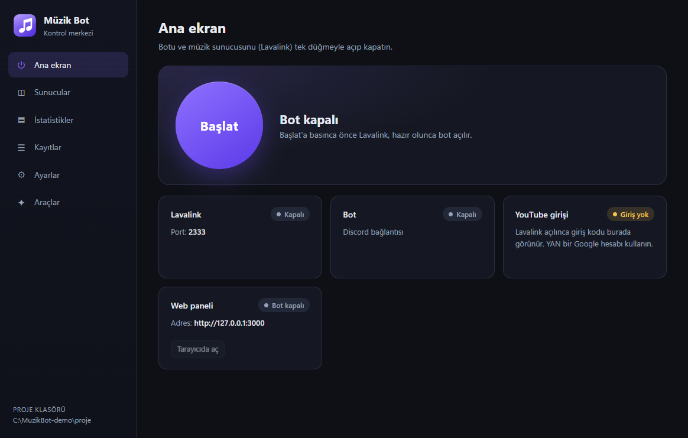
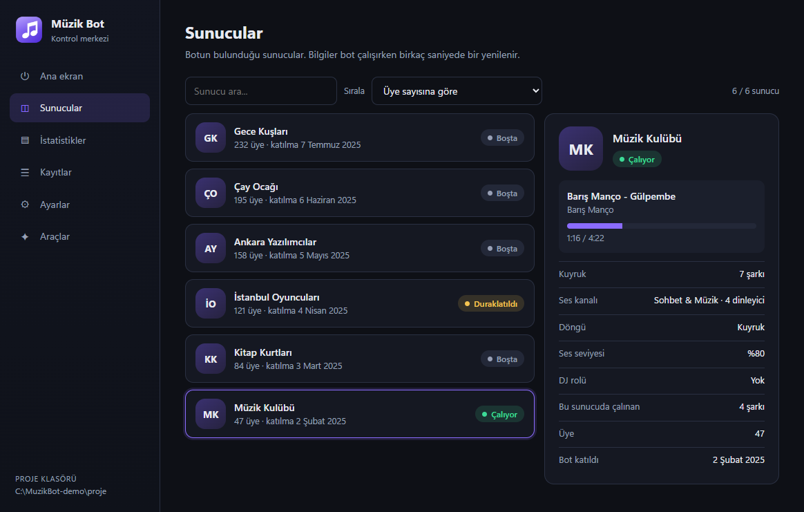
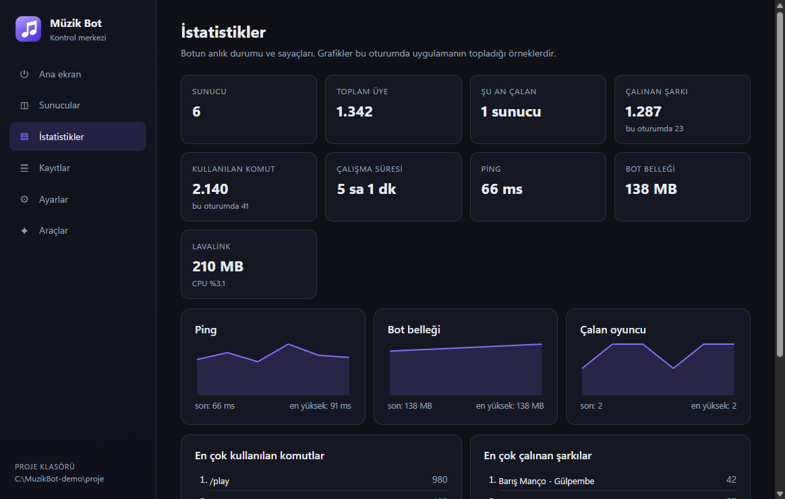
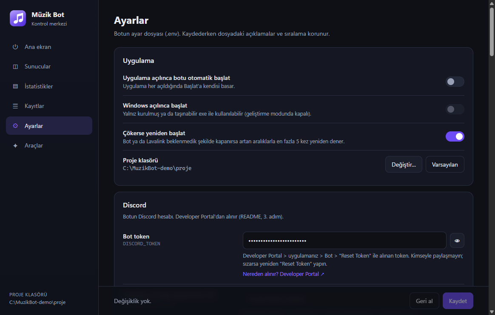
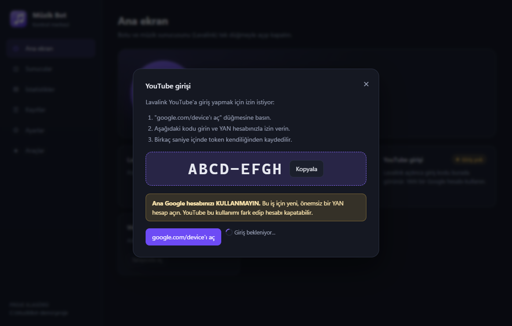

# Müzik Bot

[Türkçe](README.md) · **English**

An open-source Discord music bot that you run on your own computer. It plays YouTube (and, optionally, Spotify links through their YouTube equivalents) and works with slash (`/`) commands only. It comes with an optional web panel and a Windows desktop app that runs everything without console windows.

> **Language:** the bot's messages, the web panel and the desktop app are **Turkish only**. The full, step-by-step guide is the [Turkish README](README.md); this page is a complete but shorter English summary.

| Home | Servers | Statistics |
|---|---|---|
|  |  |  |
| **Settings (.env form)** | **YouTube sign-in wizard** | |
|  |  | |

<sub>Servers, songs and numbers in the screenshots are made-up test data.</sub>

## How it works

- **discord.js 14** on Node.js 24; voice is sent by the bot itself with **@discordjs/voice** + **@snazzah/davey** (Discord's DAVE end-to-end encrypted voice), **@discordjs/opus** and **ffmpeg**.
- **Lavalink 4.2.2** is used only over REST, for search, resolving links, the YouTube audio stream and lyrics. In some network and Windows setups the voice packets sent by Lavalink's own voice library (koe) never reached Discord, while sending from the bot with @discordjs/voice worked reliably, so Lavalink is only the search and audio source. Plugins: youtube-plugin (pinned snapshot, see below), LavaSrc (Spotify), LavaLyrics.
- **SoundCloud:** Lavalink 4.2.2's SoundCloud source loads nothing any more ("Did not detect any supported formats": SoundCloud only serves HLS/AAC). The bot resolves SoundCloud links itself through SoundCloud's web API (api-v2) with the `client_id` read from soundcloud.com's scripts, as lavaplayer does; the `client_id` is only sent to SoundCloud's API/CDN hosts over https, without following redirects, and a 429 answer is retried after 1, 2 and 4 s (or `Retry-After`, at most 10 s). ffmpeg plays SoundCloud's HLS/MP3 address (https only, `-protocol_whitelist https,tls,tcp,crypto`).
- **Direct audio links** (`.mp3`, `.ogg`, `.m4a`, `.wav`, `.flac`, `.opus`, or `Content-Type: audio/*`): links without an audio file ending go to Lavalink first (short links such as `spotify.link`, `youtu.be`, `music.youtube.com`); only when Lavalink finds nothing on a site it does not know are they tried as direct links. Lavalink's `http` source stays off; the bot downloads the audio itself and pipes it to ffmpeg (which may then open nothing but `pipe`). First only the headers are read (one `Range: bytes=0-1023` request): non-audio answers (web pages, HLS/m3u lists) and files over 100 MB are refused without downloading them. SSRF protection: http/https only, ports 80, 443 and 8000-8999 (where internet radios live), no loopback/private/link-local/CGNAT/multicast addresses (IPv4-in-IPv6 forms including ::/96 and ::ffff:0:0/96 too), names are checked at connect time and the socket connects to the checked address (no DNS rebinding), every redirect (at most 5) is checked again. Limits: 100 MB and 3 hours per file; SoundCloud and direct link loads are limited to 5 per user and 20 per server per minute. When the server drops the connection during a long pause, the file continues with a `Range` request (or is downloaded again and the received part skipped). A response without `Content-Length` or with `icy-*` headers is an internet radio: played live, reopened on resume and reconnected up to 3 times when it drops.
- **Crossfade** (0-12 s per server, off by default, kept in `data/sunucular.json`; `MusicService.setCrossfade`, `getState().crossfade`): the PCM of two ffmpeg processes is mixed in Node with equal-power curves; the next track is opened 10 s ahead and continues sample-exact on its own audio resource after the fade. ffmpeg's `acrossfade` was not used because both inputs would have to be in one ffmpeg process from the start. No crossfade into the same track (track repeat), from or into live streams, or for tracks shorter than two fade lengths; skip, seek, previous, stop and bass changes act at once. A 12 s fade costs about 30 ms of CPU.
- The **web panel** (Express) lets members of a server control the music from a browser after signing in with Discord.
- The **desktop app** (Electron, Windows) edits `.env` as a form, downloads Lavalink with a SHA-256 check, guides the YouTube sign-in, registers the commands, starts and stops the bot and Lavalink as hidden processes, and shows logs, servers and statistics.

## Requirements

| | |
|---|---|
| OS | Windows 10/11. The desktop app is Windows only. The bot and Lavalink are plain Node.js and Java and may run on Linux/macOS, but they were only tested on Windows, and the helper scripts need PowerShell 7. |
| Node.js | 24 or newer |
| Java | 17 or newer (21 recommended), for Lavalink |
| ffmpeg | On `PATH`, otherwise the optional `ffmpeg-static` package installed by `npm install` is used |
| Discord access | If Discord is blocked in your country or network, the bot cannot connect either; keep your access tool (VPN etc.) on while it runs |

## Setup

1. `npm install`
2. Create an application and a bot at <https://discord.com/developers/applications>. Copy the **Application ID** and the bot **token**. Invite the bot with `https://discord.com/oauth2/authorize?client_id=APP_ID&scope=bot+applications.commands&permissions=562950241897488`.
   - **Privileged Gateway Intents** (Developer Portal > Bot): music, `/menu`, the fixed panel, `/oyun`, free games announcements, temporary rooms, role menus and **levels/XP** need none of them (message XP only counts messages, it never reads their content). **Server Members Intent is needed** for welcome/goodbye messages and auto roles (karşılama); the log channel's member, role and nickname types and the levels setting "delete the record of members who leave" use it too. **Message Content Intent is optional**: only for the content of deleted and edited messages in the log channel (those two log types do not work without it). **Presence** is never used. To switch them on: Developer Portal > your application > **Bot** > **Privileged Gateway Intents** > turn on **Server Members Intent** and **Message Content Intent** > **Save Changes**, then restart the bot (intents are only asked for when it connects). Under 100 servers Discord needs no review. If one is off the bot does not crash: when Discord refuses the connection it reconnects first without Message Content (keeping Server Members), then without any privileged intent, and logs a Turkish warning. With only Message Content off, just the deleted/edited log types are off; with Server Members off too, the karşılama module is off and the log's member, role and nickname types are off (shown with ⚠️ in `/ayar kayit turler` and `/menu` > Ayarlar), while music, levels, rooms and role menus keep working.
   - **Permissions `562950241897488`:** a permission is only asked for once the feature that uses it is there: each feature module lists its own in `izinler`, and the value is music's set plus those (`src/bot/permissions.js`; `/invite` gives the same link and a test checks it against both READMEs). Music: View Channels, Send Messages, Embed Links, Connect, Speak (`3165184`). Control center and giveaways (they find their message again): Read Message History (`65536`). `/oyun takim` "move to channels" and temporary rooms: Move Members (`16777216`). `/oyun anket` (Discord's own polls): Send Polls (`562949953421312`, bit 49, which is why the number looks large). Temporary rooms (create, rename, set the limit, delete): Manage Channels (`16`). Role menus, level roles and auto roles, and locking a room or barring someone from it (Discord ties channel permission overwrites to it): Manage Roles (`268435456`). Rank and welcome cards (PNG): Attach Files (`32768`). Total `3165184 + 65536 + 16777216 + 562949953421312 + 16 + 268435456 + 32768 = 562950241897488`. Administrator is never asked for (modules cannot request it). Team search and the log channel need nothing new. A bot already in a server does not get new permissions by itself: invite it again with the new link or add them to its role. With Manage Roles the bot can only give roles **below its own role**: drag the bot role above the roles it gives (role menus, level roles, auto roles).
3. Choose one way to run it:
   - **Desktop app (Windows, recommended):** `npm --prefix desktop install` once, then `npm run masaustu`. Build an installer and a portable exe with `npm run masaustu:paket` (output in `desktop/dist/`). Everything below can then be done from inside the app.
   - **Command line:** copy `.env.example` to `.env` and fill it in (at least `DISCORD_TOKEN`, `DISCORD_CLIENT_ID`, `LAVALINK_PASSWORD`), run `npm run lavalink:indir` once (downloads Lavalink from GitHub and verifies its SHA-256), sign in to YouTube (next section), `npm run deploy-commands`, then `npm run hepsi` (starts Lavalink and the bot) or `npm run lavalink` and `npm start` in two windows. `npm run kontrol` checks the whole setup.

> **Unsigned executables:** the desktop app's exe files are not code-signed, so Windows SmartScreen may warn on first launch ("More info" > "Run anyway"). Building them yourself from this repository is the safest option.

### YouTube sign-in

YouTube blocks anonymous bots, so Lavalink signs in with a Google account through the OAuth device flow: start Lavalink with an empty `YOUTUBE_OAUTH_REFRESH_TOKEN`, open <https://www.google.com/device>, enter the code it prints, then run `npm run youtube-token` to store the token in `.env` (the desktop app does all of this for you). **Do not use your main Google account**: such use can get an account closed, so use a throwaway secondary account.

### Spotify (optional)

Create an app at <https://developer.spotify.com/dashboard> (Web API, redirect URI `http://127.0.0.1:8888/callback`) and put its Client ID and secret into `SPOTIFY_CLIENT_ID` / `SPOTIFY_CLIENT_SECRET`. Since February 2026 Spotify requires the app owner to have **Spotify Premium** for development-mode apps.

### Configuration

All settings live in `.env`; `.env.example` explains every key (in Turkish). Besides the Discord, Lavalink, YouTube and Spotify keys there are music behaviour settings (volume, 24/7 mode, idle timeouts, search source, queue size, embed colour), the web panel (`PANEL_*`, `DISCORD_CLIENT_SECRET`), `BOT_OWNER_IDS` for owner-only commands, and the optional `/help` links `BRAND_SUPPORT_URL`, `BRAND_AUTHOR_NAME`, `BRAND_AUTHOR_URL` (https only; empty values are not shown).

### Web panel (optional)

Set `PANEL_ENABLED=true`, `DISCORD_CLIENT_SECRET` (Developer Portal > OAuth2) and add the redirect `http://127.0.0.1:3000/auth/callback`. Open exactly `http://127.0.0.1:3000`. Only members who are in the bot's voice channel can control playback; the server-side checks also apply the `/dj` role. Do not expose it to the internet without an HTTPS reverse proxy.

## Commands

Commands are grouped so that a growing feature set stays easy to use: 17 slash commands and 3 context menu commands (`npm run deploy-commands -- --check` counts them). Descriptions are in the [Turkish README](README.md#11-komutlar).

- **Top level:** `/play`, `/skip`, `/stop`, `/queue`, `/nowplaying`, `/pause`, `/resume` (the frequent music shortcuts), `/menu`, `/oyun` (game tools, below), `/seviye` (levels, below), `/ayar` (server settings, temporary rooms, role menus, log channel, levels and welcome; "Manage Server" only), `/dj` (DJ role), `/help`, `/invite`, `/stats`, `/servers` (bot owner only), and right click on a member > Apps > **Bot menüsünü aç**, **Takıma ekle** and **Seviyesini göster** (someone's rank card, only you see it).
- **Under `/muzik`:** `search`, `playfirst`, `skipto`, `previous`, `disconnect`, `loop`, `loopqueue`, `shuffle`, `remove`, `move`, `clear`, `seek`, `volume`, `crossfade`, `bassboost`, `autoplay`, `gecmis`, `grab`, `lyrics` and the group `liste kaydet|çal|ekle|göster|sil`.

- **Under `/oyun`:**
  - `takim takimlar: kaptan: kanal1..kanal4:` splits the people (not bots) in your voice channel into 2-4 random, even teams (sizes differ by at most one), optionally with a random captain each. **Yeniden karıştır** (reshuffle) works only for whoever made the teams and members with "Manage Server". Moving (the `kanal1..kanal4` options and the **Kanallara taşı** button) is only for members with **Move Members or Manage Server**, who must also be able to connect to the source and target channels. Only people still in that voice channel are moved; a member who cannot view and connect to their team's channel is skipped and counted separately, so the bot's own permission never lets anyone into a closed channel. The bot needs Move Members. Lists live in memory only, for 3 hours. Right click on a member > Apps > **Takıma ekle** adds them to the smallest team of your latest list.
  - `zar yuz: adet:` rolls 1-100 dice with 2-1000 faces; `sec secenekler:"pizza, döner, lahmacun"` picks one of 2-50 options; `yazitura` flips a coin.
  - `anket soru: secenekler:"Cuma, Cumartesi" sure: coklu:` opens a **Discord poll** (Poll API, supported by discord.js 14.28.1 through `reply({ poll })`): 2-10 answers of up to 55 characters, 1-768 hours (default 24), single or multiple choice. Why the built-in poll rather than buttons: Discord stores the votes (the bot stores no votes and no user IDs), people can remove and change their vote, Discord draws the result bars and closes the poll on time **even while the bot is off**, and there are no message edits to rate-limit. Limits are Discord's: at least 1 hour, at most 32 days, voters are visible.
  - `cekilis odul: sure: kazanan: rol:` starts a giveaway ("Manage Server" only): duration like `30dk`, `2sa`, `1g`, `1g12sa` (1 minute to 30 days), 1-20 winners, an optional required role. People join with the **Katıl** button (counted once) and can leave. Ending early (**Şimdi bitir**) and re-rolling (**Yeniden çek**) are also for "Manage Server" only, not for the starter as such; there is no separate giveaway role setting. It ends through the persistent scheduler; if the bot was off at the end time it ends right after the next start. Ending is idempotent: two runs at once (timer and the **Şimdi bitir** button) share one run, pick the winners once and announce once, and the end job is only dropped after the announcement really went out (a failed one is retried soon). **Yeniden çek** re-rolls among those who have not won.
  - `ara oyun: kisi: not:` opens a team search (LFG) posting: a "🎮 PUBG • 1/4 aranıyor" card with **Katıl** (join), **Ayrıl** (leave) and **Kapat** (close) buttons. `kisi` is the whole team size including you (2-16); game names autocomplete. When it is full the card says the team is complete and the members are pinged once; otherwise it closes by itself after `/ayar roller-ve-ara ara-sure` hours (default 2) through the persistent scheduler, also right after a restart if the bot was off then. If a role is set for the game with `/ayar takim-ara oyun-rolu`, that role is pinged once when the posting opens (`/ayar roller-ve-ara ara-etiket deger:False` turns it off). One open posting per person and at most one new posting per person every 5 minutes; a game's role is pinged at most once per 15 minutes per server. Its owner and "Manage Server" can close it.
  - All of these are also buttons in `/menu` > **Oyun** (team search, polls and giveaways open a form; giveaways only for "Manage Server").
- **Free games announcements:** games that are free to keep on Epic Games Store, Steam and GOG are checked every two hours and once on every start; new ones are posted to the channel set with `/ayar ucretsiz-oyunlar kanal` as a card (image, normal price, last day, store link) with an optional role ping (`/ayar ucretsiz-oyunlar rol`; the role must be mentionable). `/ayar ucretsiz-oyunlar epic|steam|gog` switches platforms (all on by default). Sources: Epic's undocumented `freeGamesPromotions` endpoint (falls back to GamerPower for Epic) and the public GamerPower API (`gamerpower.com/api/giveaways?platform=steam|gog&type=game`), both verified against live replies (saved as test fixtures). Only games you keep: free-to-play games, free weekends, demos and betas, DLC and in-game loot, and third-party key giveaways are skipped (Epic: original price 0 and add-ons; GamerPower: `type=game` only, plus title and description patterns). A card Discord refuses for good (e.g. 50035 Invalid Form Body) is marked as not announceable and skipped from then on while the other games still go out; temporary errors are retried at the next check. Each game is announced once per server (also across sources and restarts; kept in `data/ucretsiz-oyunlar.json`), games that came out while the bot was off are announced on start if still valid, at most 10 cards per server per check. Network errors are quiet: one retry, then the next check. No request is made if no server has a channel set; requests use a generic User-Agent. Admins can trigger a check from `/menu` > **Bildirimler** (every 5 minutes at most).
- **Temporary voice rooms:** joining the voice channel set with `/ayar gecici-oda kanal` (e.g. "➕ Oda aç") opens a room called "**{nickname} odası**" (in `/ayar gecici-oda kategori` or the hub's category, with the `limit` default) and moves you there. The room's chat gets a control message only the owner (and "Manage Server") can use: rename (a form; Discord allows 2 renames per channel in 10 minutes, the bot says so up front), user limit, lock/unlock (only the people inside can join: @everyone and every role or member overwrite that allowed connecting, also ones copied from the category, get Connect denied; unlocking puts back exactly what the lock changed), kick (disconnects and bars from that room; members with Manage Server or Move Members and bots cannot be kicked) and hand over. When the owner leaves, someone still inside becomes the owner. An empty room is deleted 10 seconds later (cancelled if someone comes back). One room per person (also when two joins come at once with `bekleme` 0) and a cool-down (`/ayar gecici-oda bekleme`, default 30 s). The bot only edits and deletes channels **it opened and recorded in `data/gecici-odalar.json`**, and before deleting checks the channel's id, server, type (voice), category and the creation time inside its id against that record (a mismatch drops the record and leaves the channel alone, so a room moved to another category by hand, or an old record without a category, is never deleted by the bot: delete it by hand if needed); on start it deletes rooms that emptied while it was off and forgets records of rooms deleted by hand.
- **Role menus** (replacing MEE6's): `/ayar rol-menusu olustur kanal: baslik: rol1..rol5: stil: coklu:` (or `/menu` > Ayarlar > **Yeni rol paneli**, one form with title, channel, up to 25 roles and the style) posts a panel with buttons or a select menu; `ekle`/`cikar`/`sil`/`liste` manage it (panel names autocomplete; at most 25 roles per panel, 25 panels per server). A click gives or takes the role and only the clicker sees the answer; single-choice panels drop the previous role. Never allowed: @everyone, managed (bot/booster) roles, roles with Administrator, Manage Server/Roles/Channels/Messages/Nicknames/Webhooks/Expressions/Events/Threads, Kick/Ban/Timeout/Mute/Deafen/Move Members, Mention Everyone or View Audit Log, roles at or above the bot's top role, and roles at or above the admin's own top role (except the server owner). The list is shared with level roles and auto roles (`src/ozellikler/_roller.js` > `FORBIDDEN_ROLE_PERMISSIONS`). Each role is stored with the admin who put it on the panel and `_roller.js` checks everything again on every click: a role moved above the bot, given a forbidden permission, put there by someone who left, lost Manage Server or is now below the role, is not given and the clicker is told why. An old panel made before setters were stored gives no roles at all (the clicker is told an admin should set it up again; taking roles back still works), and `/ayar goster` asks to set it up again. Panel buttons are persistent and work after a restart.
- **Log channel** (replacing MEE6's): `/ayar kayit kanal kanal:#log` picks the channel and `/ayar kayit turler` (or `/menu` > Ayarlar) switches each type: members joining/leaving, deleted messages with their content and attachments, edited messages before/after, voice join/leave/move, role changes, nickname changes, bans and unbans; a bulk delete gives one summary card. Mentions in the cards never ping (even an `@everyone` in a deleted message). Bots (this one included) and the log channel itself are never logged, so log cards never trigger more logs. Deleted content cannot be fetched from Discord later, so the bot keeps what it saw in memory (below); a message sent before the bot started, or older than 24 hours, shows "İçerik bilinmiyor" (content unknown). Kicks show as "left" (telling them apart would need the audit log permission). **Private channels:** `/ayar kayit haric kanal:` excludes up to 5 channels whose messages are never logged nor cached; and when @everyone can read the log channel but not the channel a message was in, its content is not shown (nor cached). That rule only looks at @everyone, so use `haric` for channels open to some roles. **Access errors** (same rule for the log channel, welcome/goodbye messages and level-up announcements): if the channel is gone or the bot may not write there (403/404, 50001, 50013), sending pauses for that server for 5 minutes, then 10, 20... (at most 6 hours) with one console warning and a "Kayıt kanalına yazılamıyor" note in `/menu` > Ayarlar; it resumes on the first successful send or when the channel is set again (`src/ozellikler/_gonderim.js`). `/ayar kayit` is a group of its own (`kanal`, `turler`) instead of one subcommand per setting to keep `/ayar` small (Discord allows 8000 characters per command, counting every name, description and choice; `npm run deploy-commands -- --check` and a test measure each command); such settings are marked `gizli: true` in the schema and still appear in `/ayar goster`.
- **Privacy (rooms, role menus, team search, log):** `data/gecici-odalar.json` keeps only the rooms the bot opened: channel id, server, the owner's Discord user ID, opening time, lock and the control message id; the record goes with the room. `data/roller-ve-ara.json` keeps role panels (channel, message and role ids, title, and the Discord ID of the admin who put each role there, for role safety), game role mappings and open team search postings (Discord user IDs of the owner and members, game, note); a posting's record is deleted when it fills up or closes. Who took which role is **not** stored (roles live on Discord). For the log channel the bot keeps a short copy of messages it sees in servers with a log channel set (author id and name, the first 2000 characters, attachment names and sizes only, no links) **in memory only**: the last 500 messages per channel, each for at most 24 hours, at most 20,000 in total. It is **never written to disk** and is gone when the bot stops; with no log channel set nothing is kept. Log cards stay only in the Discord log channel. Turning on Message Content lets the bot read the text of messages in your server: tell your members about the log channel and make it visible to admins only.
- **Levels (`/seviye`, replaces MEE6's levels; everyone starts from zero):** `rank kullanici:` shows a rank card image (avatar, name, level, rank, XP bar); `liderlik sayfa:` is the leaderboard, 10 per page with buttons; `ver`/`al kullanici: xp:` give/take XP, `sifirla kullanici:` deletes one record or, without a user, **everyone's**; all three ask for a confirmation button (single use, valid 5 minutes, permission checked again on click). `rol seviye: rol:` links a role to a level (empty role removes it; up to 25), `haric kanal: rol:` toggles a channel/category or role that earns no XP, `roller` lists them. Admin subcommands need "Manage Server"; nobody but the server owner can give XP to themselves (XP buys level roles). `/menu` > **Seviye** has **Kartım** and **Liderlik**.
  - **Formula (same as MEE6):** going from level L to L+1 takes `5·L² + 50·L + 100` XP (totals: level 1 = 100, 2 = 255, 5 = 1,150, 10 = 4,675, 100 = 1,899,250). A message gives 15-25 XP, at most once per **60 seconds** per person; bots, webhooks, excluded channels (a category covers its channels and threads) and roles get none. Voice gives 15-25 XP every minute when at least **2 people count**: not bots, not deafened, not muted and not in an excluded role. A self-muted listener still earns but does not count, so a muted second account cannot farm XP. Deafened people, the AFK channel and excluded channels/roles get none. After a restart, whoever is in voice at that moment keeps earning; time while the bot was off is not counted.
  - **Level up:** announced in `/ayar seviye duyuru-kanal` (or the channel of the message) with the template `/ayar seviye duyuru-metni` (`{kullanıcı}`, `{ad}`, `{seviye}`, `{sunucu}`); only that person is pinged. Level roles **stack** by default; `/ayar seviye yalniz-en-yuksek` keeps only the highest one. A role the bot cannot give (above its role, deleted, no Manage Roles) is skipped and logged, never a crash. **Role safety** (level roles and auto roles): a role must be below the highest role of whoever set it up (the owner excepted), checked when it is set and again whenever it is given or taken; if that person leaves or loses Manage Server the role is no longer given, and `/ayar goster` and `/menu` > Ayarlar mark it "verilmiyor" with the reason. Taking roles away (only-highest mode, resets) only checks the bot's own hierarchy. Roles with Administrator, Manage Server/Roles/Channels/Messages/Webhooks/Nicknames/Expressions/Events/Threads, Ban, Kick, Moderate/Mute/Deafen/Move Members, Mention Everyone or View Audit Log are never handed out (list in `src/ozellikler/_roller.js`).
  - **Storage:** `data/xp.json` (schema version 1), per server and user `{ xp, level, mesajSon, sesDakika }` plus level roles and excluded lists. Changes are batched and written every few seconds (and on shutdown) with temp file + rename; a crash loses at most the last few seconds; admin changes are written at once and rolled back if the write fails; a corrupt file is kept as `*.bozuk-<time>`.
- **Welcome / goodbye and auto roles (`karsilama`, needs Server Members Intent; if it is off the bot keeps running and only this feature is off, with a Turkish note in `/ayar` and `/menu`):** messages in `/ayar karsilama hosgeldin-kanal` / `gulegule-kanal` with templates (`{kullanıcı}`, `{ad}`, `{sunucu}`, `{üye_sayısı}`; plain `{kullanici}`, `{uye_sayisi}` work too) and an optional image card; `kart-renk` sets its background colour and `kart-gorsel` an optional https background image. Auto roles: `otorol-1..3` for people, `bot-rol` for bots; with Membership Screening the roles are given once the rules are accepted (people waiting are kept in `data/karsilama-bekleyen.json`; roles go only to people on that list, once, when they accept or at startup if they accepted while the bot was off, and they leave the list; nobody off the list ever gets them back, so a role a moderator removed stays removed; entries expire after 7 days). Every role is checked again right before it is given. `/menu` > **Karşılama** shows a private preview.
- **Cards:** drawn locally as PNG with `@napi-rs/canvas` (no external card service): rank 934×282, welcome 1024×450, text in the bundled **Noto Sans** and **Noto Emoji** fonts (`assets/fonts`, SIL Open Font License 1.1) so Turkish letters render everywhere; emoji are monochrome. Avatars are downloaded only from `https://cdn.discordapp.com` (5 s, 2 MB); background images only over https from public hosts (local and private network addresses refused with the music player's rules in `src/music/netGuard.js`, checked again at connect time; every redirect re-checked), PNG/JPEG/WebP/GIF up to 4 MB and 4096×4096 px; the size is read from the file header before decoding. Downloads and finished cards are cached briefly; at most 2 cards render at once. Measured here: ~11 ms per rank card, ~33 ms per welcome card with a background, ~0.1 ms from the cache.
- **Privacy (levels):** the level system has to **store Discord user IDs**: `data/xp.json` keeps, per server, the ID of everyone who earned XP with their XP, level, time of their last rewarded message and voice minutes. Message content, user names and avatars are **not** stored (names and avatars are fetched from Discord when a card is drawn; avatars stay in memory for 30 minutes). The file stays on the bot's computer. Delete with `/seviye sifirla` (one person or everyone) or let `/ayar seviye ayrilinca-sil deger:True` delete members who leave (off by default: the record stays). Tell your server members about it. For role safety the **Discord ID of whoever set up a role** is stored: for auto roles in `data/ozellikler.json` (`_kim` per server), for level roles in `data/xp.json` (`roller.<level>.kim`); it goes when the setting is reset or the link removed. People waiting for membership screening are kept in `data/karsilama-bekleyen.json` (server, user ID, join time) until they get their roles, leave, or 7 days pass.
- **Privacy (game features):** giveaway participants' Discord user IDs are kept in `data/cekilisler.json` only while the giveaway runs and for 24 hours after it ends (for re-rolls); then the whole giveaway record is deleted. Polls store nothing (votes are on Discord). Team lists are never written to disk. `data/ucretsiz-oyunlar.json` holds no personal data.

**Old name → new name:** every music command that is not a top-level shortcut moved under `/muzik` with the same options and behaviour: `/search` → `/muzik search`, `/loop` → `/muzik loop`, `/volume` → `/muzik volume`, `/liste kaydet` → `/muzik liste kaydet`, and so on. `/liste` already was a group of subcommands; it went under `/muzik` because Discord allows two levels (`/muzik liste kaydet`), which keeps every music command in one place. Run `npm run deploy-commands` once after updating: the old names disappear from Discord.

- **Control center (`/menu`):** an ephemeral menu built with Discord's Components V2 (Container, Section, Separator, Text Display). Its sections come from the feature modules and are filtered per viewer: **Müzik** for everyone (current song with cover art and a Discord-rendered end time, next songs, the same previous/pause/skip/stop/repeat/shuffle buttons as the "now playing" message, an **add song** form that runs the `/play` flow, queue, saved lists and history pickers), **Oyun** for everyone (one entry gathering the team, dice, poll and, for "Manage Server", giveaway sections; shown in `/menu` only, not on the fixed panel), and **Bildirimler** (free games) and **Ayarlar** only for members with "Manage Server" (settings, the temporary rooms hub picker, the role panel list with a **Yeni rol paneli** form and the log type picker); **Oyun** also has **Takım ara** (team search form). The level section comes with that feature; empty sections are not shown. Buttons use persistent custom ids (`oz:<module>:<action>`), so old menus keep working after a restart.
- **Fixed panel (`/ayar panel kanal:#channel`):** a public "Kontrol Merkezi" message showing the current song live, with the music buttons and a button that opens `/menu` for whoever clicks it. It is edited at most every 5 seconds (`/ayar menu panel-aralik`, 3-60) and only when what it shows changed. Its message id is kept in `data/paneller.json`; after a restart the bot reconnects to the same message, sends a new one if it was deleted, and forgets the panel if the channel is gone. `/ayar panel kaldir:True` removes it.
- **Settings (`/ayar`):** `/ayar goster` lists every setting; `/ayar <module> <setting> deger:` changes one (empty shows it, `sifirla:True` resets it). The subcommands are generated from each module's settings schema (channel, role, text, number, on/off) with validation: channel type and server, the bot's send permission, no @everyone/managed/dangerous roles, role hierarchy, text length, number range. Values are stored per server in `data/ozellikler.json` (schema version 1, atomic writes, corrupt files kept as `.bozuk-*`).
- **Control buttons:** the "now playing" message has buttons for previous, pause/resume, skip, stop, repeat (off → track → queue) and shuffle. They follow the same rules as the commands (be in the bot's voice channel, the `/dj` role); anyone else gets a short warning only they can see. The message is updated when the state changes and is removed (or loses its buttons) when the song ends.
- **`/muzik previous`:** plays the previous song again; the current one goes back to the front of the queue. Works with every repeat mode and after the queue ended.
- **`/muzik autoplay`:** per server, kept in `data/sunucular.json`; on by default (also for servers with no saved value), off only once someone turns it off. When the queue runs out, a song similar to the last YouTube song is added: first from YouTube's own mix (`watch?v=<id>&list=RD<id>`, loaded through Lavalink), otherwise from an artist + title search. None of the last 50 played songs is picked again, nor a song autoplay picked earlier that failed to play; after 3 failures in a row autoplay stops for that queue (one notice in the channel) until someone queues a song; nothing is added to an empty voice channel, and the idle leave rules stay as they are.
- **`/muzik liste kaydet|çal|ekle|göster|sil ad:`:** saved playlists per server in `data/listeler.json` (atomic writes). Each song keeps only what Lavalink can load again: address, title, duration (plus the YouTube address for Spotify songs). Up to 500 songs per list and 50 lists per server; names autocomplete. Only the list's creator or someone with "Manage Server" can delete it. Privacy note: for that rule `data/listeler.json` stores the Discord user ID of each list's creator (nothing else about users). `/muzik liste çal` starts the first song as soon as it loads and queues the rest in the background with a "120/500 eklendi" progress message; one list load per server at a time.
- **`/muzik gecmis`:** the last 20 songs played on the server, with a menu to queue one again. The last 100 per server are kept in memory and in `data/gecmis.json`, without who requested them.

Feature modules live in `src/ozellikler/<module>/` (commands, persistent components, settings schema, menu section, event listeners, scheduled jobs and their own `mesajlar.js`); the persistent scheduler keeps planned jobs in `data/zamanlayici.json` and runs the ones that became due while the bot was off at startup (at least once: a failing job, one that runs longer than 60 seconds, or one that was cut off by a crash is retried up to 5 times with growing waits, then kept as failed; a job never runs twice at the same time; job handlers must be safe to run twice).

After updating, run `npm run deploy-commands` once so Discord shows the new commands.

## Voice commands (optional)

While the bot is in a voice channel, people can control the music by speaking Turkish: "**müzik bot**, tarkan dudu dudu aç" (play), "**müzik bot**, müziği durdur" (pause, the queue is kept). Speech is recognised on this computer (faster-whisper); audio is never sent anywhere and never written to disk. The feature is **off by default** and is switched on per server.

- **Install (once, bot owner):** needs [uv](https://docs.astral.sh/uv/getting-started/installation/). Desktop app > **Araçlar** > **Sesli komut bileşenini kur**: **GPU** for NVIDIA cards (≈ 4 GB: CUDA libraries ≈ 2 GB, large-v3-turbo 1.6 GB, small 0.5 GB) or **CPU only** (≈ 1 GB), with progress, cancel (resumes on the next run) and remove. It goes to `%LOCALAPPDATA%\MuzikBot\sesli-komut` (venv, models, `kurulum.json`), not into the project. Packages are installed from hash-locked `stt/requirements*.txt` (made with `uv pip compile --generate-hashes`) with `--require-hashes --only-binary :all:` (no source builds); the models are pinned to Hugging Face commits and checked with SHA-256 (`stt/model_indir.py`). The home screen's "Sesli komut" card shows not installed / ready / running (GPU/CPU). Manual install commands are in the Turkish README, section 15.
- **Switch on (server admin):** `/ayar sesli-komut acik deger:True`; `uyandirma` sets the wake phrase (default "müzik bot", neutral on purpose). The speech model is bot-wide and the **bot owner's** setting: `SESLI_KOMUT_MODEL` in `.env` (also in the desktop app's settings) = `otomatik` (turbo on a GPU with ≥ 3 GB free VRAM, else small) / `turbo` / `small`. "Kaldır" (remove) deletes only the installer's own `venv\`, `models\` and `kurulum.json`, only where that manifest exists, and never a drive root or the user profile.
- **Commands** (after the wake phrase; the patterns are data in `src/ozellikler/sesli-komut/kaliplar.js`, the whole sentence must match one; fillers like "şu, bir, lütfen, abi" are skipped; Turkish numbers, durations and ordinals are understood). Besides the ones below: set volume ("sesi yüzde elli yap"), seek ("otuz saniye ileri sar", "başa sar"), jump in the queue ("üçüncü şarkıya geç"), information ("çalan şarkı ne", "sırada ne var", "kaç şarkı var"), add to the queue ("kuyruğa X ekle"), play next ("hemen X çal"), saved lists ("gece listemi çal"), queue repeat, repeat off and autoplay on/off. A near miss gets "anlamadım — '...' mı dediniz?"; an ambiguous sentence does nothing. Original list: "<song> aç/çal" play, "müziği kapat / kapat / bitir / kuyruğu temizle / listeyi temizle / çalma" stop (empties the queue, turns repeat and autoplay off; unlike `/stop` the bot stays and keeps listening, then leaves by the usual rules), "geç/atla" skip, "durdur / dur / duraklat / bekle" pause (the queue is kept; ignored when already paused), "devam et" resume (ignored when not paused), "sesi kıs/aç" volume ∓/± 20, "önceki" previous, "karıştır" shuffle, "tekrarla" track repeat. The bot answers in the text channel ("🎙️ **Ali**: ▶️ … çalıyorum" or "anlamadım").
- **Rules:** the same as for slash commands (speaker in the bot's channel, the DJ role for DJ commands), plus 5 commands per person and 15 per server in 30 seconds. Against wrong commands: the wake phrase must be in the first 3 words (edit distance ≤ 2, a dropped first syllable tolerated); transcripts with a high no-speech probability or a repetition loop are dropped; stop/skip/pause/volume-down need a second recognition pass to agree; commands that make no sense in the current state are ignored; with several commands in one sentence only the first counts; a command is dropped when its sentence waited more than 4 s in the worker's queue (a full queue drops the oldest), ended more than 5 s ago, or when the song changed after it was said ("aç/çal" excepted).
- **Tip:** with Discord's voice activity the microphone opens late and the first syllable can be cut ("luay bot"). Lower the input sensitivity or use push-to-talk; saying "Hey <wake phrase>" also helps ("hey, ey, şey, evet, tamam, bak, abi" before the wake phrase are skipped). A cut wake phrase is accepted only with evidence that the audio start was cut (speech within the first 150 ms of the received audio, never at a 10 s split), only at the sentence start, with the other words exact and at least the last 3 letters of the first word that are not an ordinary word ("luay bot" yes; "ay bot", "vay bot", "kolay bot", "okay bot" no); every command after a cut match needs the second pass and a miss stays silent. Measured (TTS, GPU, 28 commands cut at the start): 0 ms 21, 150 ms 14, 250 ms 7 correct, always 0 wrong commands and 0 wake-ups on non-commands.
- **Diagnosis mode (debugging only):** `SESLI_KOMUT_TANI=true` in `.env` (or the desktop app's settings), restart the bot. ⚠️ **In diagnosis mode the text of sentences with a wake phrase is logged, and the desktop app saves logs to disk.** One line per such sentence: a per-session randomly salted speaker tag, VAD onset, recognised text, scores, wake match (full or cut), intent, passes and the gate that stopped it; ordinary talk is logged only as "yoksay:uyandirma" with its length, never its text. Sentences with a wake phrase but no command go to `data/sesli-komut-anlasilmayan.json` (last 200, text and time only; `npm run sesli-komut:anlasilmayan`), which is deleted at start when diagnosis mode is off. Switch it on for your own test and off again. When off, no text is written; a once-a-minute counter line shows frames, sentences and results.
- **Opting out:** anyone can exclude their own voice with `/muzik sesli-komut beni-dinleme` (their packets are dropped undecoded), undo it with `/muzik sesli-komut beni-dinle`, and see the state with `/muzik sesli-komut durum` (also a button in `/menu`).
- **Privacy and Discord's rules:** the bot joins **undeafened only in servers where the feature is on**; elsewhere it stays deafened and receives no audio. **To comply with Discord's policy**, while the feature is on the bot posts "🎙️ Sesli komut açık — kendini hariç tutmak için `/muzik sesli-komut beni-dinleme`" every time it joins a voice channel or is moved to another one (at most once per channel in 10 minutes); this notice cannot be turned off. Discord's Developer Policy and Terms expect user data, voice included, to be processed transparently: tell people before switching it on. Audio is processed in memory and dropped; recognised text is never logged. The worker process gets none of the `.env` values and stays offline; only the installer downloads (PyPI, NVIDIA, Hugging Face).
- **How it works:** one subscription per speaker (DAVE end-to-end encrypted voice via `@discordjs/voice`), Opus → 16 kHz mono, a long-lived Python worker (`stt/stt_worker.py`, length-prefixed frames on stdin/stdout) with Silero VAD and faster-whisper (GPU: large-v3-turbo int8_float16; CPU: small int8 with a 1.5 s wake-phrase pre-check). The worker only runs while the bot is in a channel of a server with the feature on, and is killed when it leaves (VRAM freed); a crashing worker is restarted after 2, 10 and 30 s, then retried every 5 minutes while needed; a speaker whose DAVE decryption breaks is resubscribed with a growing backoff. Audio kept for the second pass lives at most 15 s and is dropped at once when the speaker leaves or opts out.
- **Measured** (Ryzen 7 9800X3D, RTX 5070 Ti, Turkish TTS recordings, end to end without Discord): turbo ≈ 0.11 s per sentence, 21/28 correct commands across clean/Opus/music/noise conditions with 0 wrong commands and 0 wake-ups on 12 non-commands; CPU small ≈ 0.9 s, 14/28, 0 wrong. Real speech varies with microphone and noise.

## Known limitations

- **Sources:** YouTube, Spotify and SoundCloud links, direct audio file links, internet radio links and song names can be played (Spotify needs Premium as noted above). Bandcamp, Twitch, Vimeo etc. can be searched but not played yet.
- **SoundCloud uses an unofficial API:** the bot uses the api-v2 endpoints of SoundCloud's own website with a `client_id` taken from its scripts, not registered API access. SoundCloud's terms of use may restrict such access and downloading content; using it is the bot owner's responsibility, and SoundCloud can block or change it at any time (SoundCloud links then fail with an error message). No SoundCloud search, no Go+ previews or geo-blocked tracks, no lyrics for SoundCloud and direct links.
- **YouTube live streams are not supported for now (deliberate decision):** they are detected (youtube-plugin reports them with `isStream: false` and the time since the stream started as length; YouTube does not accept uploads over 12 hours) and refused with a clear message. Reason: youtube-plugin has no route that returns the live HLS manifest (`/youtube/stream` fails for live streams, `/v4/loadtracks` does not contain it), and talking to YouTube directly, bypassing the plugin, would be fragile (client versions and signatures change often) and risky (the OAuth account and IP exposed without the plugin's handling). **Alternative:** direct internet radio stream links (Icecast/Shoutcast) play as live streams.
- **Direct links:** at most 100 MB and 3 hours; private network addresses are deliberately blocked; some `.m4a` files with the index (moov) at the end cannot be read from a pipe.
- **Crossfade** starts at the stated duration of a track; a long silence at its end falls into the fade.
- **Seeking can be slow** on long tracks: the audio is buffered in memory first.
- **Memory:** each playing track is buffered per server, and Lavalink uses its own heap (`LAVALINK_JAVA_MEMORY`, 512 MB by default).
- **YouTube changes often.** The youtube-plugin is pinned to a **snapshot commit** because the latest stable release (1.18.2) could not play most videos at the time; the snapshot's iOS client works without signature deciphering. Switch back to a numbered release once one works again (details in the Turkish README, *Teknik notlar > YouTube eklentisi*).
- **While the bot is off:** giveaway ends and free games checks happen when it starts again (late, not lost). Team lists are lost on restart. Welcome/goodbye messages, auto roles and XP (messages and voice) of that time are missed.
- **Free games sources:** Epic's endpoint is undocumented and may change (then GamerPower is used for Epic). GamerPower's store links redirect through GamerPower; its end times are approximate.
- **Voice commands:** receiving audio is not documented by Discord and may break with a Discord update. Turkish only; noise, accents or quiet microphones cause misses (it mostly does nothing rather than the wrong thing). Commands are only heard while the bot is in a voice channel.
- Tested on Windows only.

## Development

```powershell
npm test                    # bot tests
npm run check               # node --check for every file + command definition check
npm run format:check        # Prettier
npm --prefix desktop test   # desktop app tests
```

`test/contract.test.js` pins what the desktop app relies on (entry points, console lines, `.env` keys and the `data/durum.json` status file schema).

## Disclaimer

This is an unofficial project. It is not affiliated with, endorsed by or connected to YouTube, Google, Spotify or Discord. You are responsible for how you use it and for complying with those platforms' terms of service. The software is provided "as is", see [LICENSE](LICENSE).

## Third-party components

None of these are included in this repository; `npm install`, `npm run lavalink:indir` and Lavalink's first start download them from their own sources. Licenses were checked against the upstream repositories.

| Component | Used for | License |
|---|---|---|
| [Lavalink](https://github.com/lavalink-devs/Lavalink) | Search, sources, YouTube stream | MIT |
| [youtube-source / youtube-plugin](https://github.com/lavalink-devs/youtube-source) | YouTube source for Lavalink | MIT |
| [LavaSrc](https://github.com/topi314/LavaSrc) | Spotify mirroring, lyrics sources | Apache-2.0 |
| [LavaLyrics](https://github.com/topi314/LavaLyrics) | Lyrics | Apache-2.0 |
| [discord.js](https://github.com/discordjs/discord.js) | Discord client | Apache-2.0 |
| [@discordjs/voice](https://github.com/discordjs/discord.js/tree/main/packages/voice) | Voice connection | Apache-2.0 |
| [@discordjs/opus](https://github.com/discordjs/opus) | Opus encoding | MIT |
| [@snazzah/davey](https://github.com/Snazzah/davey) | DAVE end-to-end encryption | MIT |
| [Express](https://github.com/expressjs/express), express-session, express-rate-limit | Web panel | MIT |
| [ffmpeg-static](https://github.com/eugeneware/ffmpeg-static) (optional) | ffmpeg binary when none is on `PATH` | GPL-3.0-or-later (the FFmpeg builds it downloads are GPL too) |
| [Electron](https://github.com/electron/electron), [electron-builder](https://github.com/electron-userland/electron-builder) | Desktop app | MIT |
| [@napi-rs/canvas](https://github.com/Brooooooklyn/canvas) | Drawing the rank and welcome cards (Skia, prebuilt for Windows, no system libraries) | MIT |
| [faster-whisper](https://github.com/SYSTRAN/faster-whisper), [CTranslate2](https://github.com/OpenNMT/CTranslate2) (optional) | Voice commands: speech recognition | MIT |
| [Whisper](https://github.com/openai/whisper) weights: [large-v3-turbo](https://huggingface.co/mobiuslabsgmbh/faster-whisper-large-v3-turbo), [small](https://huggingface.co/Systran/faster-whisper-small) (CTranslate2 conversions; optional) | Voice command models | MIT |
| [Silero VAD](https://github.com/snakers4/silero-vad) (inside faster-whisper), [ONNX Runtime](https://github.com/microsoft/onnxruntime) | Speech start/end detection | MIT |
| NVIDIA cuBLAS, cuDNN, CUDA Runtime (pip wheels, GPU install only) | GPU acceleration | NVIDIA software license (EULA); never in the repository, downloaded from NVIDIA's PyPI packages at install |
| [uv](https://github.com/astral-sh/uv) (installed by the user) | Creating the Python environment | MIT / Apache-2.0 |

The only third-party files **included** in this repository are the card fonts [Noto Sans](https://github.com/notofonts/latin-greek-cyrillic) and [Noto Emoji](https://github.com/googlefonts/noto-emoji) in `assets/fonts`, both under the [SIL Open Font License 1.1](https://openfontlicense.org) (license texts next to them). The OFL allows bundling the fonts with software; they may not be sold on their own.

## License, contributing, security

- [MIT License](LICENSE)
- [Contributing](CONTRIBUTING.md)
- Report vulnerabilities privately as described in [SECURITY.md](SECURITY.md), not in public issues.
