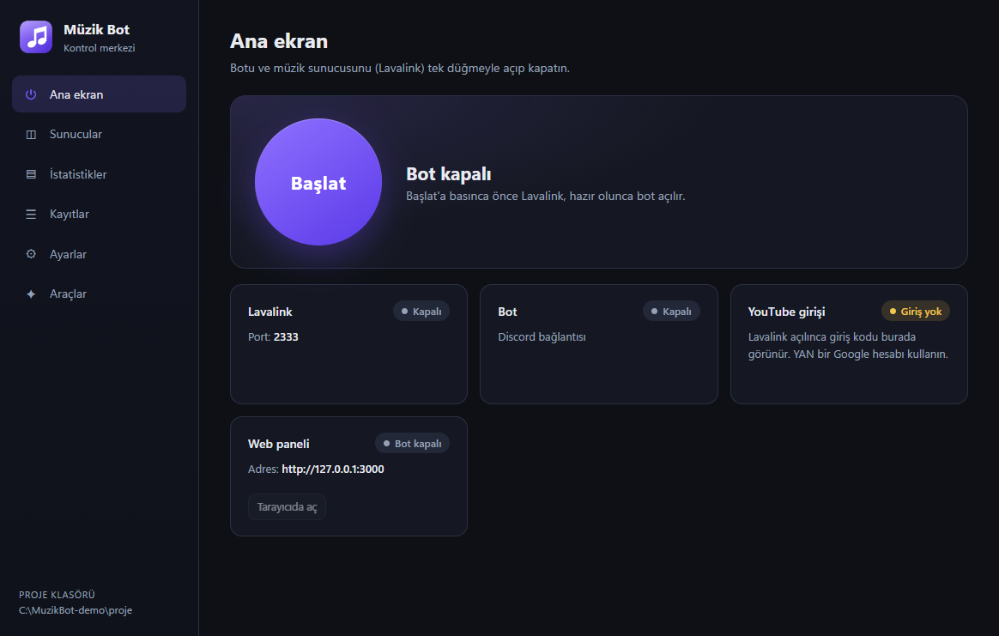
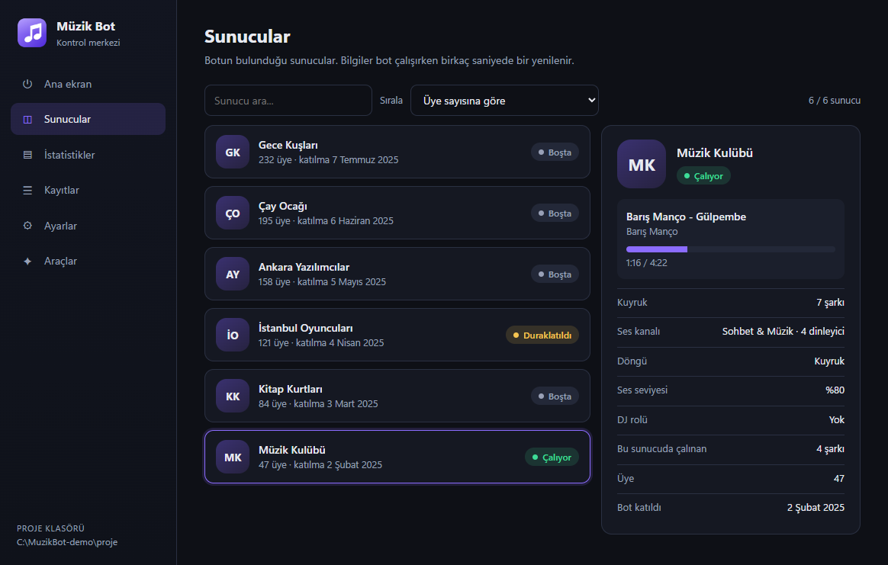
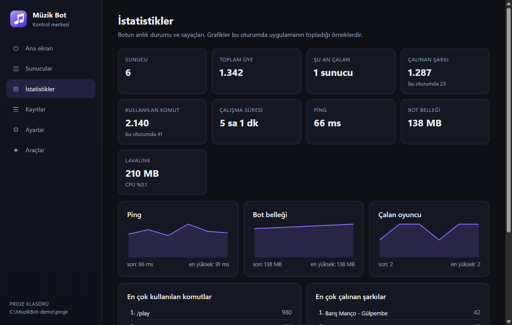
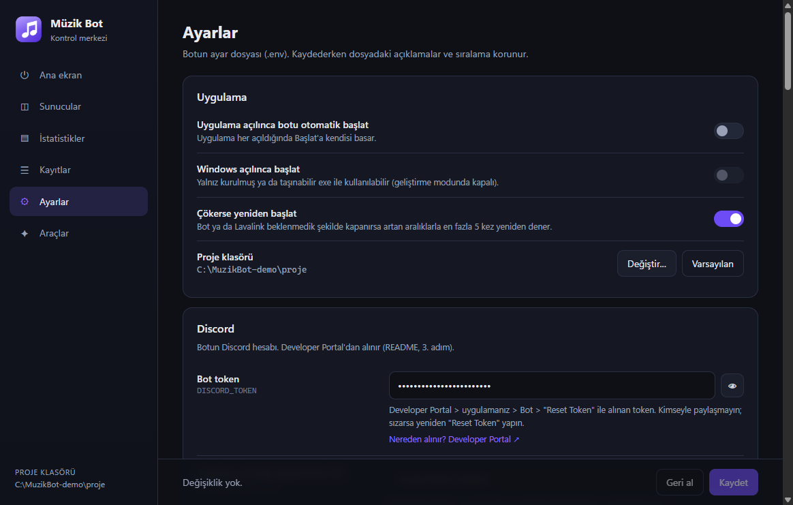
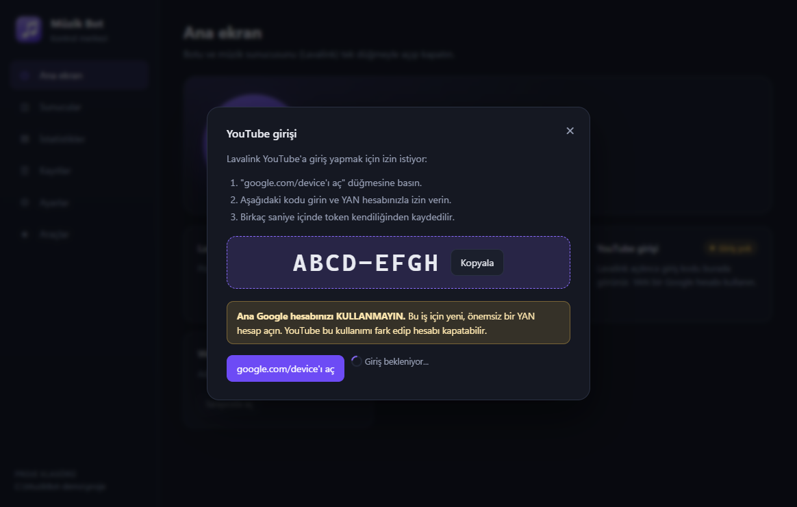

# Müzik Bot

**Türkçe** · [English](README.en.md)

Discord için açık kaynak müzik botu. YouTube'dan (ve isteğe bağlı olarak Spotify bağlantılarından) müzik çalar, yalnız eğik çizgi (`/`) komutlarıyla çalışır. Botu kendi bilgisayarınızda çalıştırırsınız; isterseniz tarayıcıdan yönetilen bir web paneli ve konsol pencereleri açmadan her şeyi yöneten bir Windows masaüstü uygulaması da var. Botun, panelin ve uygulamanın arayüzü Türkçedir.

- **discord.js 14.28.1** (Node.js 24)
- **@discordjs/voice 0.19.2** + **@snazzah/davey** (Discord'un 2 Mart 2026'dan beri zorunlu tuttuğu DAVE uçtan uca şifreli ses): sesi Discord'a botun kendisi gönderir
- **@discordjs/opus 0.11.0** (Opus kodlama) ve **ffmpeg** (sistemdeki; yoksa `ffmpeg-static`)
- **Lavalink 4.2.2** (REST): arama, bağlantı çözme, YouTube ses akışı ve şarkı sözleri; ses kanalına kendisi bağlanmaz (bkz. Teknik notlar)
- Lavalink eklentileri: **youtube-plugin (master snapshot `2be8e54`, bkz. Teknik notlar)**, **LavaSrc 4.8.3** (Spotify), **LavaLyrics 1.1.0** (şarkı sözleri)

> **Discord erişimi:** Ülkenizde ya da ağınızda Discord'a erişim engelliyse bot da bağlanamaz. Bu durumda bot çalışırken kullandığınız erişim aracının (VPN, DPI atlatma aracı vb.) açık olması gerekir.

| Ana ekran | Sunucular | İstatistikler |
|---|---|---|
|  |  |  |
| **Ayarlar (.env formu)** | **YouTube girişi sihirbazı** | |
|  |  | |

<sub>Ekran görüntülerindeki sunucular, şarkılar ve sayılar test için uydurulmuş verilerdir.</sub>

### Kurulum yolları

- **A) Masaüstü uygulamasıyla (Windows, önerilen):** 1-3. adımları yapın (Node, Java, `npm install`, Discord'da bot oluşturma), sonra uygulamayı açın: `npm --prefix desktop install` bir kez, ardından `npm run masaustu`. Kurulum dosyası ya da taşınabilir exe üretmek için `npm run masaustu:paket` (çıktı `desktop/dist/`). Uygulama `.env` dosyasını form olarak düzenler, Lavalink'i indirir, YouTube girişini adım adım yaptırır, komutları kaydeder ve botu tek düğmeyle başlatıp durdurur; aşağıdaki 4-9. adımları uygulamanın içinden yapabilirsiniz.
- **B) Komut satırıyla:** Aşağıdaki adımları sırayla izleyin.

> **İmzasız exe:** Masaüstü uygulamasının exe dosyaları kod imzası taşımaz. Windows SmartScreen ilk açılışta "Windows bilgisayarınızı korudu" uyarısı gösterebilir; "Ek bilgi" > "Yine de çalıştır" ile açabilirsiniz. Exe'yi bu depodan kendiniz derlemek en güvenli yoldur.

---

## İçindekiler

1. [Gerekenler](#1-gerekenler)
2. [Bağımlılıkları kurun](#2-bağımlılıkları-kurun)
3. [Discord'da botu oluşturun](#3-discordda-botu-oluşturun)
4. [.env dosyasını doldurun](#4-env-dosyasını-doldurun)
5. [Spotify uygulaması (isteğe bağlı)](#5-spotify-uygulaması-isteğe-bağlı)
6. [Lavalink'i indirip başlatın](#6-lavalinki-indirip-başlatın)
7. [YouTube girişi (ilk sefere özel)](#7-youtube-girişi-ilk-sefere-özel)
8. [Komutları Discord'a kaydedin](#8-komutları-discorda-kaydedin)
9. [Botu başlatın](#9-botu-başlatın)
10. [Web paneli](#10-web-paneli)
11. [Komutlar](#11-komutlar)
12. [Sık karşılaşılan hatalar](#12-sık-karşılaşılan-hatalar)
13. [Kendin düzenlemek istersen](#13-kendin-düzenlemek-istersen)
14. [Teknik notlar](#14-teknik-notlar)
15. [Sesli komut (isteğe bağlı)](#15-sesli-komut-isteğe-bağlı)

Bütün komutlar bu klasörde açılmış bir **PowerShell** penceresinde yazılır. Klasörü açmanın kolay yolu: Dosya Gezgini'nde `Müzik Bot` klasörüne girin, adres çubuğuna `pwsh` yazıp Enter'a basın.

---

## 1. Gerekenler

| Program | Neden | Kontrol |
|---|---|---|
| Windows 10/11 | Masaüstü uygulaması yalnız Windows'ta çalışır. Bot ve Lavalink Node.js ve Java ile Linux/macOS'ta da çalışabilir, ancak yalnız Windows'ta denendi; başlatma betikleri PowerShell 7 ister | |
| Node.js 24 veya üstü | Botun kendisi | `node -v` |
| Java 17 veya üstü (önerilen 21) | Lavalink ses sunucusu | `java -version` |
| ffmpeg | Sesi Discord'a uygun biçime çevirir; PATH'te yoksa `npm install` ile gelen `ffmpeg-static` kullanılır | `ffmpeg -version` |
| PowerShell 7 | Başlatma betikleri (masaüstü uygulaması gerektirmez) | `pwsh -v` |

Java yoksa: [Adoptium Temurin 21](https://adoptium.net/) indirip kurun (kurulumda "Add to PATH" seçili olsun).

## 2. Bağımlılıkları kurun

```powershell
npm install
```

## 3. Discord'da botu oluşturun

1. <https://discord.com/developers/applications> adresine gidin, **New Application** deyin, bir ad verin.
2. **General Information** sayfasındaki **Application ID** değerini kopyalayın. Bu sizin `DISCORD_CLIENT_ID` değeriniz.
3. Soldan **Bot** sekmesine geçin:
   - **Reset Token** düğmesine basın, çıkan token'ı kopyalayın. Bu sizin `DISCORD_TOKEN` değeriniz. **Kimseyle paylaşmayın.** Token sızarsa yeniden "Reset Token" yapın.
   - **Privileged Gateway Intents** bölümü: müzik, `/menu`, kalıcı panel, `/oyun`, ücretsiz oyun duyuruları, geçici odalar, rol menüleri ve **seviye/XP** bunların hiçbirini **gerektirmez** (mesaj XP'si mesajları yalnız sayar, içeriğini okumaz). Bot hangi intent'i isteyeceğine açık olan özelliklere bakarak karar verir.
     - **Server Members Intent**: hoş geldin/güle güle mesajı ve otomatik rol (karşılama) için **gerekli**; kayıt kanalında giren/çıkan üyeler, rol ve takma ad değişiklikleri ve seviyede "ayrılanın kaydını sil" ayarı da bunu kullanır.
     - **Message Content Intent**: **isteğe bağlı**; yalnız kayıt kanalında silinen ve düzenlenen mesajların **içeriği** için (bu iki kayıt türü bu anahtar olmadan çalışmaz).
     - **Presence Intent**: hiçbir özellik kullanmaz, kapalı bırakın.

     Açmak için adım adım:
     1. <https://discord.com/developers/applications> > uygulamanız > soldan **Bot**.
     2. Aşağı kaydırıp **Privileged Gateway Intents** başlığını bulun.
     3. **Server Members Intent** anahtarını açın.
     4. **Message Content Intent** anahtarını açın.
     5. Sayfanın altında çıkan **Save Changes** düğmesine basın.
     6. Bot açıksa kapatıp yeniden başlatın (intent'ler yalnız bağlanırken istenir).

     Bot 100'den az sunucudaysa Discord'un ayrıca onay vermesi gerekmez. Bir anahtar kapalıysa bot çökmez: Discord bağlantıyı reddedince önce yalnız Message Content olmadan (Server Members ile), o da olmazsa hiçbir ayrıcalıklı intent olmadan yeniden bağlanır ve konsola Türkçe bir uyarı yazar. Yalnız Message Content kapalıysa kayıtta silinen/düzenlenen mesaj türleri kapanır, gerisi çalışır. Server Members de kapalıysa karşılama modülü kapanır (kullanılınca "özellik kapalı" der), kayıtta üye, rol ve takma ad türleri kapanır (`/ayar kayit turler` ve `/menu` > Ayarlar bunları ⚠️ ile gösterir); müzik, seviye, geçici odalar ve rol menüleri çalışmaya devam eder.
4. Botu sunucunuza davet edin. Aşağıdaki adreste `UYGULAMA_ID` yerine Application ID'nizi yazıp tarayıcıda açın:

   ```text
   https://discord.com/oauth2/authorize?client_id=UYGULAMA_ID&scope=bot+applications.commands&permissions=562950241897488
   ```

   `562950241897488` şu izinleri verir. Bot bir izni ancak onu kullanan özellik eklendiğinde ister: her özellik modülü kendi izinlerini tanımındaki `izinler` alanıyla bildirir, sayı müziğin izinleriyle bunların toplamıdır (`src/bot/permissions.js`; bot çalışırken `/invite` de aynı bağlantıyı verir, bir test sayıyı README ile eşler).

   | Özellik | İzin | Değer |
   |---|---|---|
   | Müzik ve "Şimdi çalıyor" mesajları | Kanalları Görüntüle, Mesaj Gönder, Bağlantı Yerleştir, Bağlan, Konuş | 3165184 |
   | Kontrol merkezi (kalıcı panel: bot yeniden başlayınca eski mesajı bulur) ve çekiliş (bitişte kendi mesajını bulup kazananları yazar) | Mesaj Geçmişini Oku | 65536 |
   | `/oyun takim` "Kanallara taşı" düğmesi | Üyeleri Taşı | 16777216 |
   | `/oyun anket` (Discord'un kendi anketi) | Anket Oluştur (Send Polls) | 562949953421312 |
   | Geçici odalar: odayı açma, adını ve kişi sınırını değiştirme, silme (taşıma için Üyeleri Taşı zaten var) | Kanalları Yönet | 16 |
   | Rol menüleri, seviye rolleri ve otomatik rol (rol verip alma); geçici odayı kilitleme ve birini atma (kanal izinlerini değiştirmek Discord'da bu izne bağlı) | Rolleri Yönet | 268435456 |
   | Seviye kartı ve hoş geldin kartı (PNG) | Dosya Ekle | 32768 |

   Toplam: 3165184 + 65536 + 16777216 + 562949953421312 + 16 + 268435456 + 32768 = **562950241897488**. Sayı büyük görünüyor, çünkü "Anket Oluştur" Discord'un 49. izin bitidir; yönetici (Administrator) izni **istenmez**, modüller onu isteyemez. Ücretsiz oyun duyuruları, takım arama ve kayıt kanalı yeni izin istemez (mesaj gönderir; rol etiketi için rolün etiketlenebilir olması yeter). Bot, rolleri yalnız **kendi en yüksek rolünün altındaysa** verebilir: Sunucu Ayarları > Roller'de bot rolünü dağıtacağı rollerin (rol menüsü, seviye ve otomatik roller) üstüne sürükleyin. Bot zaten bir sunucudaysa yeni izinler kendiliğinden gelmez: yeni bağlantıyla yeniden davet edin ya da Sunucu Ayarları > Roller'de bot rolüne bu izinleri elle ekleyin.

## 4. .env dosyasını doldurun

1. `.env.example` dosyasını kopyalayın ve kopyanın adını `.env` yapın:

   ```powershell
   Copy-Item .env.example .env
   ```

2. `.env` dosyasını Not Defteri ile açın (`notepad .env`) ve doldurun:
   - `DISCORD_TOKEN=` → 3. adımdaki token
   - `DISCORD_CLIENT_ID=` → Application ID
   - `LAVALINK_PASSWORD=` → **kendi uydurduğunuz** bir şifre (bot ve Lavalink bunu ortak kullanır)
   - `DISCORD_GUILD_ID=` → isteğe bağlı: sunucunuzun kimliği. Doldurursanız komutlar o sunucuda **hemen** görünür. (Discord'da Ayarlar > Gelişmiş > Geliştirici Modu'nu açın, sunucu adına sağ tıklayıp "Sunucu Kimliğini Kopyala" deyin.)
3. Diğer ayarlar (ses seviyesi, 24/7, bekleme süreleri) dosyadaki açıklamalarla birlikte gelir; varsayılanlar çoğu kişi için uygundur.
   - `TWENTY_FOUR_SEVEN=true` yaparsanız bot ses kanalından kendiliğinden hiç ayrılmaz.
   - `DEFAULT_VOLUME=80` yeni çalmaya başlarken kullanılan ses seviyesidir.
   - `PLAY_SHOW_CHOICES=true` (varsayılan): `/play` şarkı adıyla kullanılınca ilk 5 sonuç numaralı bir listede çıkar, komutu yazan kişi düğmeyle seçer (60 saniye). `false` yaparsanız liste çıkmaz, ilk sonuç doğrudan çalar. Bağlantı ve çalma listeleri her zaman doğrudan çalar.
   - `BOT_OWNER_IDS=` (isteğe bağlı): `/servers` komutunu kullanabilecek kişilerin Discord kimlikleri, virgülle ayrılmış. Boşsa bot sahibini Developer Portal'dan kendisi bulur (uygulama bir takımdaysa takım sahibi ve Admin üyeleri).

> Kurallar: `=` işaretinin yanlarına boşluk koymayın. Bir değerin içinde `#` varsa değeri tırnağa alın: `LAVALINK_PASSWORD="ab#cd"`.

## 5. Spotify uygulaması (isteğe bağlı)

Spotify bağlantıları (şarkı, albüm, çalma listesi) YouTube'daki karşılıklarıyla çalınır. Bunun için bir Spotify geliştirici uygulaması gerekir:

1. <https://developer.spotify.com/dashboard> adresine Spotify hesabınızla girin, **Create app** deyin.
2. Ad ve açıklama yazın. **Redirect URI** alanına `http://127.0.0.1:8888/callback` yazın (kullanılmıyor ama alan zorunlu). **Web API** kutusunu işaretleyin, kaydedin.
3. Uygulamanın **Settings** sayfasından **Client ID** ve **Client secret** değerlerini `.env` içindeki `SPOTIFY_CLIENT_ID` ve `SPOTIFY_CLIENT_SECRET` satırlarına yazın.
4. Lavalink'i yeniden başlatın. Açılışta "Spotify desteği: AÇIK" yazmalı.

> **Önemli:** Spotify, Şubat 2026'dan beri "Development Mode" uygulamaları için uygulama sahibinin **Spotify Premium** üyesi olmasını şart koşuyor. Premium yoksa Spotify bağlantıları hata verir; YouTube etkilenmez.

## 6. Lavalink'i indirip başlatın

Lavalink, botun sesi işleyen ayrı programıdır. Bir kez indirin:

```powershell
npm run lavalink:indir
```

Bu komut Lavalink 4.2.2'yi **yalnızca resmi GitHub sürüm sayfasından** indirir ve dosyanın SHA-256 özetini GitHub'ın yayımladığı değerle karşılaştırır. Uyuşmazsa dosyayı siler.

Başlatmak için:

```powershell
npm run lavalink
```

- İlk açılışta YouTube, Spotify ve şarkı sözü eklentilerini kendisi indirir (`lavalink/plugins` klasörüne).
- "**Lavalink is ready to accept connections.**" yazısını görünce hazırdır.
- Lavalink yalnız bu bilgisayardan (127.0.0.1) bağlantı kabul eder.
- Bu pencere açık kalmalı. Kapatmak için pencerede `Ctrl+C`.

## 7. YouTube girişi (ilk sefere özel)

YouTube botları engellediği için Lavalink bir Google hesabıyla giriş yapar.

> ⚠️ **Ana Google hesabınızı KULLANMAYIN.** Bu amaçla yeni, önemsiz bir **yan hesap** açın. YouTube bu tür kullanımı fark edip hesabı kapatabilir.

1. `npm run lavalink` ile Lavalink'i başlatın. `.env` içinde `YOUTUBE_OAUTH_REFRESH_TOKEN` boşsa pencerede şuna benzer bir satır çıkar:

   ```text
   OAUTH INTEGRATION: To give youtube-source access to your account, go to https://www.google.com/device and enter code XXX-XXX-XXX
   ```

2. Tarayıcıda <https://www.google.com/device> adresine gidin, koddaki harfleri girin ve **yan hesabınızla** izin verin.
3. Birkaç saniye içinde Lavalink penceresinde "**Token retrieved successfully**" yazar.
4. **Yeni** bir PowerShell penceresinde şunu çalıştırın; token `.env` dosyasına kendiliğinden yazılır:

   ```powershell
   npm run youtube-token
   ```

5. Lavalink'i kapatıp (`Ctrl+C`) yeniden başlatın. Artık kod sorulmaz.

## 8. Komutları Discord'a kaydedin

Bunu ilk kurulumda ve komutlar değiştiğinde bir kez yapmanız yeterli:

```powershell
npm run deploy-commands
```

> **Güncelleme notu:** Bu sürümde komutlar yeniden düzenlendi: sık kullanılan müzik komutları üstte kaldı, diğerleri `/muzik` altına taşındı (11. adımdaki "Eski ad → yeni ad" tablosu); yeni `/menu`, `/ayar`, `/oyun` ve sağ tık > Uygulamalar > "Bot menüsünü aç" ile "Takıma ekle" geldi. Discord'da görünmeleri için `npm run deploy-commands` komutunu **bir kez yeniden** çalıştırın; eski komut adları (`/search`, `/loop` ...) bu sırada Discord'dan silinir. Bir komutun açıklamasını `src/mesajlar.js` (ya da `src/ozellikler/*/mesajlar.js`) içinde değiştirdiğinizde de aynısını yapın.

- `DISCORD_GUILD_ID` doluysa komutlar o sunucuda hemen çıkar.
- Boşsa tüm sunuculara kaydedilir; görünmesi birkaç dakika sürebilir. Görünmezse Discord'u `Ctrl+R` ile yenileyin.
- Yalnız tanımları denetlemek için (token gerekmez): `npm run deploy-commands -- --check`

## 9. Botu başlatın

İki yol var:

**A) Tek komutla (önerilen):**

```powershell
npm run hepsi
```

Lavalink kapalıysa ayrı bir pencerede açar, hazır olmasını bekler, sonra botu bu pencerede başlatır.

**B) Ayrı ayrı:** bir pencerede `npm run lavalink`, ikinci pencerede:

```powershell
npm start
```

"Discord'a giriş yapıldı" ve "Lavalink bağlandı" yazılarını gördüyseniz bot hazırdır. Bir ses kanalına girip `/play` deneyin.

**Kurulum kontrolü:** Bir şey çalışmıyorsa `npm run kontrol` çalıştırın; neyin eksik olduğunu tek tek yazar.

## 10. Web paneli

Bot çalışırken tarayıcıdan da yönetilebilir: çalan şarkı ve ilerleme, kuyruk, ses seviyesi, duraklat/devam, atla, durdur, karıştır, tekrar, kuyruktan silme ve şarkı ekleme. Sayfa canlı güncellenir. Panel botla aynı programın içinde çalışır, ayrıca başlatmanız gerekmez.

**Kim ne yapabilir?** Panele Discord hesabıyla girilir. Bir sunucuyu yalnız o sunucunun üyeleri görebilir. Müziği **yalnızca botla aynı ses kanalında olan** üyeler yönetebilir; diğer üyeler izler. (Bot henüz bir kanalda değilse, ses kanalındaki bir üye şarkı ekleyince bot o kanala girer.) Sunucuda `/dj` ile bir DJ rolü ayarlıysa panelde de Discord'daki kural geçerlidir: kontrol düğmelerini yalnız DJ rolü olanlar, sunucu yöneticileri ya da botla kanalda tek başına olan kişi kullanabilir (şarkı eklemek herkese açık). Bu kurallar sunucu tarafında, Discord'un bilgisine göre denetlenir.

### Kurulum

1. Developer Portal'da uygulamanızı açın > **OAuth2** sekmesi:
   - **Client Secret** altında **Reset Secret** deyin ve çıkan değeri `.env` içindeki `DISCORD_CLIENT_SECRET=` satırına yazın. **Kimseyle paylaşmayın.**
   - **Redirects** bölümünde **Add Redirect** deyip tam olarak şunu yazın ve kaydedin:

     ```text
     http://127.0.0.1:3000/auth/callback
     ```

     (`PANEL_PUBLIC_URL` değerini değiştirdiyseniz onun sonuna `/auth/callback` ekleyin.)
2. `.env` içinde:
   - `PANEL_ENABLED=true`
   - `PANEL_SESSION_SECRET=` → en az 32 karakterlik rastgele bir metin. Üretmek için PowerShell'de:

     ```powershell
     node -e "console.log(require('crypto').randomBytes(32).toString('base64url'))"
     ```

3. Botu yeniden başlatın. Konsolda `Web paneli açık: http://127.0.0.1:3000` yazar. Tarayıcıda **tam olarak bu adresi** açın (`localhost` değil `127.0.0.1`; adres farklı olursa giriş güvenlik kontrolünden geçmez).
4. Panel adresi `/help` ve `/stats` komutlarında da görünür.

Paneli istemiyorsanız `PANEL_ENABLED=false` yapın; bot eskisi gibi çalışır ve web sunucusu hiç başlamaz.

### Paneli başka cihazlardan ya da internetten açmak

Varsayılan olarak panel yalnız bu bilgisayardan açılır (127.0.0.1). Bu en güvenli ayardır.

> ⚠️ **Güvenlik uyarısı:** Paneli internete açacaksanız `PANEL_HOST`'u değiştirip modemden port yönlendirmek **yerine** HTTPS sağlayan bir **ters proxy** kullanın (ör. [Caddy](https://caddyserver.com/) otomatik sertifika alır). Şifresiz (http) bağlantıda oturum çereziniz ağda okunabilir. Önerilen düzen:
>
> - Panel `PANEL_HOST=127.0.0.1` ile yalnız yerelde dinlemeye devam eder; ters proxy aynı bilgisayarda çalışıp `https://alanadiniz` adresini `127.0.0.1:3000`'e yönlendirir.
> - `.env`: `PANEL_PUBLIC_URL=https://alanadiniz` ve `PANEL_TRUST_PROXY=true`.
> - Developer Portal'daki Redirect adresini `https://alanadiniz/auth/callback` olarak güncelleyin.
> - Ev internetinde dışarıdan erişim için sabit IP ya da dinamik DNS gerekebilir; ayrıca modeminizde yalnız 443 portunu açın.

## 11. Komutlar

Komut sayısı arttıkça kullanmak zorlaşmasın diye komutlar gruplandı: en sık kullanılanlar üstte, diğer müzik komutları `/muzik` altında, oyun araçları `/oyun` altında, sunucu ayarları `/ayar` altında. Hiç komut yazmak istemeyenler için `/menu` her şeyi düğmelerle açar. Toplam: 17 eğik çizgi komutu + 3 sağ tık komutu (`npm run deploy-commands -- --check` sayar).

**Üst düzey komutlar**

| Komut | Ne yapar |
|---|---|
| `/play şarkı:` | Şarkı adı yazılırsa ilk 5 sonucu listeler, düğmeyle seçtiğinizi çalar (`PLAY_SHOW_CHOICES`); bağlantı ya da çalma listesi doğrudan çalar |
| `/skip` | Çalan şarkıyı atlar |
| `/stop` | Durdurur, kuyruğu temizler, kanaldan ayrılır |
| `/queue sayfa:` | Kuyruğu sayfa sayfa gösterir (◀️ ▶️ düğmeleri) |
| `/nowplaying` | Çalan şarkı ve ilerleme çubuğu |
| `/pause`, `/resume` | Duraklatır / devam ettirir |
| `/menu` | Kontrol merkezini açar (yalnız siz görürsünüz; aşağıda) |
| `/oyun ...` | Takım kurma, takım arama, zar, seçim, yazı tura, anket ve çekiliş (aşağıda) |
| `/seviye ...` | Seviye kartı, liderlik tablosu ve yönetici XP araçları (aşağıda) |
| `/ayar ...` | Sunucu ayarları, kalıcı panel, geçici odalar, rol menüleri, kayıt kanalı, seviye ve karşılama. Yalnız "Sunucuyu Yönet" izni olanlar (aşağıda) |
| `/dj rol:` / `/dj kaldır:True` | DJ rolünü ayarlar ya da kaldırır (aynı rolü yeniden seçmek de kaldırır); boş bırakılırsa şu anki rolü söyler. Yalnız "Sunucuyu Yönet" izni olanlar |
| `/help` | Komutları kategori kategori gösterir; alttaki menüden kategori seçilir (Müzik, Oyun, Seviye, Genel, Ayarlar). Liste komutların kendisinden otomatik oluşur |
| `/invite`, `/stats` | Davet bağlantısı, istatistikler |
| `/servers` | Botun bulunduğu sunucuları ad ve üye sayısıyla listeler. Yalnız bot sahibi kullanır, cevabı yalnız o görür |
| Sağ tık > Uygulamalar > **Bot menüsünü aç** | Bir üyeye sağ tıklayıp kontrol merkezini açar. "Seviyesini göster" sonraki aşamada gelecek |
| Sağ tık > Uygulamalar > **Takıma ekle** | Üyeyi son 3 saatte kurduğunuz takım listesinin en küçük takımına ekler (botlar eklenemez) |

**`/muzik` altındaki komutlar**

| Komut | Ne yapar |
|---|---|
| `/muzik search şarkı:` | 10 sonuç listeler, menüden seçtiğinizi çalar |
| `/muzik playfirst sıra:` | Kuyruktaki şarkıyı başa alır (çalan şarkıdan sonra o çalar) |
| `/muzik skipto sıra:` | Kuyrukta o sıradaki şarkıya atlar |
| `/muzik previous` | Önceki şarkıyı yeniden çalar; çalan şarkı kuyruğun başına döner (tekrar modları korunur, kuyruk bittikten sonra da çalışır) |
| `/muzik disconnect` | `/stop` ile aynı |
| `/muzik loop` | Çalan şarkıyı tekrarla (aç/kapat) |
| `/muzik loopqueue` | Tüm kuyruğu tekrarla (aç/kapat) |
| `/muzik shuffle` | Kuyruğu karıştırır |
| `/muzik remove sıra:` | Kuyruktan bir şarkı çıkarır |
| `/muzik move parça: konum:` | Bir şarkının sırasını değiştirir |
| `/muzik clear` | Kuyruğu temizler (çalan şarkı sürer) |
| `/muzik seek zaman:` | Şarkıda zamana atlar (`1:30`, `90`, `2dk 10sn`) |
| `/muzik volume seviye:` | Ses seviyesi (1–150; boş bırakılırsa mevcut seviyeyi söyler) |
| `/muzik crossfade saniye:` | Şarkılar arası geçiş süresi (0–12 sn, 0 = kapalı; boş bırakılırsa mevcut süreyi söyler) |
| `/muzik bassboost seviye:` | Bas güçlendirme: Kapalı, Düşük, Orta, Yüksek |
| `/muzik autoplay durum:` | Otomatik çalma: kuyruk bitince son şarkıya benzer bir şarkı ekler. Boş bırakılırsa açık/kapalı arasında geçer; ayar sunucu başına kalıcıdır; varsayılan olarak AÇIK, kaydı olmayan sunucuda da açıktır |
| `/muzik liste kaydet ad:` | Çalan şarkıyı ve kuyruğu bu adla kayıtlı liste yapar |
| `/muzik liste çal ad:` | Kayıtlı listeyi kuyruğa ekler |
| `/muzik liste ekle ad:` | Çalan şarkıyı listeye ekler (liste yoksa oluşturur) |
| `/muzik liste göster ad:` | Ad boşsa sunucunun listelerini, doluysa o listenin şarkılarını sayfa sayfa gösterir |
| `/muzik liste sil ad:` | Listeyi siler. Yalnız listeyi oluşturan kişi ya da "Sunucuyu Yönet" izni olanlar |
| `/muzik gecmis sayfa:` | Son çalınan 20 şarkı; menüden seçilen şarkı yeniden kuyruğa eklenir |
| `/muzik grab` | Çalan şarkıyı size özel mesajla gönderir |
| `/muzik lyrics şarkı:` | Şarkı sözleri (boşsa çalan şarkı) |

`/liste` zaten kendi alt komutları olan bir gruptu; `/muzik liste` altına alındı, çünkü Discord iki seviyeye izin veriyor (`/muzik liste kaydet`) ve böylece bütün müzik komutları tek yerde duruyor, üst düzeyde yer kaplamıyor. Listeleri yazmadan çalmak için `/menu` > Müzik > **Listeler** daha kısa yoldur.

**`/oyun` altındaki komutlar**

| Komut | Ne yapar |
|---|---|
| `/oyun takim takimlar: kaptan: kanal1: ... kanal4:` | Ses kanalınızdaki insanları (botlar hariç) rastgele ve dengeli 2-4 takıma böler (takımlar arasında en çok 1 kişi fark). `kaptan:True` her takıma rastgele bir kaptan seçer. **Yeniden karıştır** düğmesini yalnız takımları kuran ve "Sunucuyu Yönet" izni olanlar kullanabilir. Taşıma (`kanal1`...`kanal4` seçenekleri ve **Kanallara taşı** düğmesi) yalnız "Üyeleri Taşı" ya da "Sunucuyu Yönet" izni olanlara açıktır; taşıyan kişinin de kaynak ve hedef kanallara bağlanma izni olmalı. Her takıma bir ses kanalı seçilmiş olmalı; yalnız hâlâ o ses kanalında (ya da takım kanallarında) olanlar taşınır. Hedef kanalı görme ve ona bağlanma izni olmayan üye taşınmaz ve sonuçta ayrıca sayılır; botun izni kimseyi kapalı bir kanala sokmaz. Bot rolünde "Üyeleri Taşı" izni gerekir |
| `/oyun zar yuz: adet:` | Zar atar: 2-1000 yüzlü, 1-100 tane (varsayılan bir tane 6 yüzlü); birden fazlaysa toplamı da yazar |
| `/oyun sec secenekler:` | `pizza, döner, lahmacun` gibi, virgülle ayrılmış 2-50 seçenekten birini rastgele seçer |
| `/oyun yazitura` | Yazı tura atar |
| `/oyun anket soru: secenekler: sure: coklu:` | Discord'un kendi anketini açar: 2-10 seçenek (virgülle ayrılmış: `Cuma, Cumartesi`; her biri en çok 55 karakter), süre saat olarak 1-768 (varsayılan 24), `coklu:True` ile birden fazla seçim. Herkes tek oy verir (çoklu seçimde birden çok seçenek) ve oyunu kaldırıp değiştirebilir; sonuç çubukları canlı görünür, süre dolunca anket kendiliğinden kapanır. Bot kanalda "Anket Oluştur" iznine sahip olmalı |
| `/oyun cekilis odul: sure: kazanan: rol:` | Çekiliş başlatır (yalnız "Sunucuyu Yönet"): süre `30dk`, `2sa`, `1g`, `1g12sa` gibi (1 dakika - 30 gün), 1-20 kazanan, isteğe bağlı gerekli rol. Mesajdaki **Katıl** / **Ayrıl** ile katılınır (bir kişi bir kez sayılır). Süre dolunca kazananlar mesajda ve kanala yazılan duyuruda etiketlenir. **Şimdi bitir** (erken bitirme) ve **Yeniden çek** (daha önce kazanmamış katılımcılardan yenilerini seçme) de yalnız "Sunucuyu Yönet" izni olanlara açıktır, başlatan kişiye ayrıca tanınmaz |
| `/oyun ara oyun: kisi: not:` | Takım arkadaşı arama ilanı: "🎮 PUBG • 1/4 aranıyor" kartı, **Katıl** / **Ayrıl** / **Kapat** düğmeleri. `kisi` takımdaki toplam kişi (siz dahil, 2-16); oyun adı yazarken öneri çıkar. Dolunca kart "takım tamam" olur ve katılanlar bir kez etiketlenir; dolmazsa `/ayar roller-ve-ara ara-sure` saat sonra (varsayılan 2) kendiliğinden kapanır, bot o sırada kapalıysa açılışta kapanır. Oyunun rolü `/ayar takim-ara oyun-rolu` ile ayarlıysa ilan açılınca o rol bir kez etiketlenir (`/ayar roller-ve-ara ara-etiket deger:False` ile kapanır). Herkesin aynı anda tek açık ilanı olur ve bir kişi 5 dakikada en fazla bir ilan açar; bir oyunun rolü bir sunucuda 15 dakikada en fazla bir kez etiketlenir (arada açılan ilanlar etiketsiz gider). İlanı açan ve "Sunucuyu Yönet" izni olanlar kapatabilir |

Hepsi kontrol merkezinde de var: `/menu` > **Oyun** bölümünde "2/3/4 takım", "Takım ara" (form açar), "Zar at", "Yazı tura", "Anket oluştur" (form açar) ve yöneticilere "Çekiliş başlat" (form açar). Sonuçlar kanala herkese açık yazılır; etiketlenen kişilere bildirim gitmez (çekiliş kazananları hariç).

**Neden Discord'un kendi anketi:** Discord'un Poll API'si discord.js 14.28.1'de `reply({ poll })` ile destekleniyor (`PollData`: soru, en çok 10 cevap, saat olarak süre, çoklu seçim). Düğmeli bir ankete göre üstünlükleri: oylar Discord'da tutulur, bot hiçbir oy ya da kullanıcı kimliği saklamaz; oy değiştirme, sonuç çubukları ve süresi dolunca kapanma Discord'un kendi arayüzüyle olur ve **bot kapalıyken de** çalışır; hız sınırına takılacak mesaj düzenlemesi yoktur. Sınırları Discord'unkidir: en az 1 saat, en çok 32 gün; oy verenleri Discord'da herkes görebilir (gizli oy yoktur).

**Çekilişin bitişi:** Bitiş kalıcı zamanlayıcıyla yapılır (`data/zamanlayici.json`). Bot bitiş saatinde kapalıysa çekiliş, bot açılır açılmaz sonuçlanır. Bitiş iki kez çalışsa da (ör. zamanlayıcı ile **Şimdi bitir** aynı anda) kazananlar bir kez seçilir ve duyuru bir kez yapılır; aynı anda gelen ikinci bitiş ilkini bekler. Duyuru gönderilemezse (ör. Discord geçici olarak yanıt vermiyor) bitiş işi silinmez ve kısa süre sonra yeniden dener.

**Ücretsiz oyun duyuruları:** Epic Games Store, Steam ve GOG'da **kalıcı olarak** ücretsiz alınabilen oyunlar iki saatte bir (ve bot her açıldığında bir kez) kontrol edilir; yenisi ayarlanan kanala kartla duyurulur: oyunun görseli, normal fiyatı, son gün (Discord'un kendi saydığı zaman) ve **Mağazada aç** bağlantısı. Kaynaklar: Epic için Epic'in kendi mağaza sayfasının kullandığı `freeGamesPromotions` adresi (belgesiz; bozulursa Epic için de GamerPower'a geçilir), Steam ve GOG için GamerPower'ın açık API'si (`gamerpower.com/api/giveaways`). Ücretsiz oynanan (zaten bedava) oyunlar, "free weekend" denemeleri, demo ve betalar, DLC ve oyun içi eşyalar ile başka sitelerin anahtar dağıtımları ("Key Giveaway") duyurulmaz: Epic'te normal fiyatı 0 olanlar ve DLC'ler, GamerPower'da `type=game` dışındakiler (DLC, Loot, Beta) ve başlığı ya da açıklaması bunları söyleyenler elenir. Discord'un kalıcı olarak reddettiği bir kart (ör. geçersiz içerik, 50035) o oyun için bir daha denenmez ve "duyurulamadı" diye kaydedilir, diğer oyunlar duyurulmaya devam eder; geçici hatalarda bir sonraki kontrolde yeniden denenir. Aynı oyun bir sunucuda iki kez duyurulmaz (iki kaynakta da çıksa); duyurulanlar `data/ucretsiz-oyunlar.json` dosyasında tutulur. Bot kapalıyken çıkan ve hâlâ geçerli olanlar açılışta duyurulur; süresi geçenler duyurulmaz. Bir kontrolde sunucu başına en çok 10 kart gider. Kaynağa ulaşılamazsa bot sessizce geçer, bir kez yeniden dener ve bir sonraki kontrolde tekrar bakar. Hiçbir sunucuda kanal ayarlı değilse hiç istek gitmez. İstekler genel bir User-Agent ile gider (kişisel bilgi yok). Yöneticiler `/menu` > **Bildirimler** > **Şimdi kontrol et** ile beklemeden kontrol ettirebilir (5 dakikada bir).

**`/seviye` komutları (MEE6'nın seviye sisteminin yerine)**

| Komut | Ne yapar |
|---|---|
| `/seviye rank kullanici:` | Görsel seviye kartı: profil fotoğrafı, ad, seviye, sıra ve XP çubuğu (boşsa sizin). Sağ tık > Uygulamalar > **Seviyesini göster** aynısını yalnız size gösterir |
| `/seviye liderlik sayfa:` | Liderlik tablosu, sayfa başına 10 kişi, ◀️ ▶️ düğmeleriyle |
| `/seviye ver kullanici: xp:` / `/seviye al kullanici: xp:` | XP verir / alır (en çok 10.000.000; XP sıfırın altına inmez). Önce **Onayla** düğmesi çıkar |
| `/seviye sifirla kullanici:` | Bir kişinin XP kaydını siler; `kullanici` boşsa **herkesinkini**. Onaylıdır, geri alınamaz |
| `/seviye rol seviye: rol:` | Bir seviyeye rol bağlar (en çok 25); `rol` boşsa bağı kaldırır. Rol `/ayar`'daki gibi denetlenir |
| `/seviye haric kanal: rol:` | Kanalı (ya da kategoriyi) veya rolü XP almayanlara ekler; yeniden yazınca çıkarır (en çok 25 + 25) |
| `/seviye roller` | Seviye rollerini, rol modunu ve XP almayan kanal/rolleri listeler |

`ver`, `al`, `sifirla`, `rol` ve `haric` yalnız "Sunucuyu Yönet" izni olanlara açıktır. Kimse kendine XP veremez (yalnız sunucu sahibi): XP seviye rolü kazandırdığı için bir yönetici rolleri kendine böyle almasın. onay düğmesi tek kullanımlıktır, 5 dakika geçerlidir ve tıklanınca izin yeniden denetlenir. `/menu` > **Seviye** bölümünde **Kartım** ve **Liderlik** düğmeleri vardır.

**XP kuralları (MEE6 ile aynı formül, herkes sıfırdan başlar):**

- L. seviyeden L+1'e geçmek için `5 × L² + 50 × L + 100` XP gerekir. Toplam: 1. seviye 100, 2. seviye 255, 5. seviye 1.150, 10. seviye 4.675, 20. seviye 23.850, 50. seviye 268.375, 100. seviye 1.899.250 XP.
- **Mesaj:** her mesaj rastgele 15-25 XP; aynı kişi **60 saniyede en çok bir kez** XP alır (aradaki mesajlar sayılmaz). Botlar, webhook'lar, XP almayan kanallar (bir kategori seçilirse içindeki kanallar ve başlıklar da) ve roller almaz. Mesajın içeriği okunmaz.
- **Ses:** dakikada bir, rastgele 15-25 XP. Kanalda **en az 2 sayılan kişi** olmalı: bot olmayan, sağırlaştırılmamış, susturulmamış (kendini ya da sunucu tarafından) ve XP almayan rolde olmayan. Kendini susturan kişi XP alır (konuşmadan dinleyenler de katılımcıdır) ama bu sayıma girmez; böylece ikinci bir hesabı susturup kanala koyarak XP kasılamaz. Sağırlaştıran, AFK kanalındaki ve XP almayan kanal ya da roldeki kişi XP almaz. Bot yeniden başlayınca o anda seste olanlar sayılmaya devam eder; bot kapalıyken geçen süre sayılmaz.
- **Seviye atlama:** duyuru `/ayar seviye duyuru-kanal` kanalına, ayarlı değilse mesajın yazıldığı kanala (seste atlayanlar için ses kanalının sohbetine) yazılır; `/ayar seviye duyuru deger:False` kapatır. Metin `/ayar seviye duyuru-metni` ile değişir: `{kullanıcı}` (etiket), `{ad}`, `{seviye}`, `{sunucu}`. Yalnız seviye atlayan kişi etiketlenir; metinde `@everyone` yazsa da kimseye bildirim gitmez.
- **Seviye rolleri:** varsayılan olarak **birikir** (5. ve 10. seviye rolleri birlikte kalır, MEE6 gibi); `/ayar seviye yalniz-en-yuksek deger:True` ile yalnız ulaşılan en yüksek rol kalır, alttakiler alınır. Roller seviye atlayınca (ve `ver`/`al`/`sifirla` sonrası) güncellenir; yeni bağlanan bir rol, kişiler bir sonraki seviye atlamalarında alır. Bot bir rolü veremezse (rol botun rolünün üstünde, silinmiş, "Rolleri Yönet" izni yok) çökmez: o rolü atlar ve konsola saatte en çok bir kez yazar.
- **Rol güvenliği (seviye rolleri, otomatik rol):** bir rolü bağlayan kişinin en yüksek rolünden **aşağıda** olmalı (sunucu sahibi hariç); bu hem ayarlanırken hem de rol her verilip alınırken yeniden denetlenir. Rolü bağlayan sunucudan ayrılır ya da "Sunucuyu Yönet" iznini kaybederse o rol artık verilmez (yeniden ayarlanmalı); `/ayar goster` ve `/menu` > Ayarlar böyle bir rolü "⚠️ verilmiyor" uyarısı ve nedeniyle gösterir. Rol **alınırken** ("yalnız en yüksek", sıfırlama) yalnız botun hiyerarşisi denetlenir. Şu izinlerden biri olan rol hiçbir özellikle dağıtılamaz: Yönetici, Sunucuyu Yönet, Rolleri Yönet, Kanalları Yönet, Mesajları Yönet, Webhook'ları Yönet, Üyeleri Yasakla, Üyeleri At, Zaman Aşımı (Moderate Members), @everyone Etiketle, Kullanıcı Adlarını Yönet, İfadeleri Yönet, Etkinlikleri Yönet, Denetim Kaydını Görüntüle, Üyeleri Sustur, Üyeleri Sağırlaştır, Üyeleri Taşı, Başlıkları Yönet (liste: `src/ozellikler/_roller.js`).

**Hoş geldin / güle güle ve otomatik rol (karşılama, MEE6'nın yerine):** Server Members Intent gerekir (3. adım); kapalıysa bot çökmez, bu özellik kapanır ve `/ayar` ile `/menu` bunu Türkçe söyler. Ayarlar `/ayar karsilama ...` altında (aşağıdaki tablo). Katılana hoş geldin, ayrılana güle güle mesajı gider (kanal seçilmemişse gitmez); ikisinde de isteğe bağlı görsel kart (profil fotoğrafı, ad, sunucu ve üye sırası) olur. Şablonlar: `{kullanıcı}` (etiket), `{ad}`, `{sunucu}`, `{üye_sayısı}` (Türkçe karaktersiz yazım da olur: `{kullanici}`, `{uye_sayisi}`). Hoş geldinde yalnız gelen kişi etiketlenir, güle güle kimseyi etiketlemez. Otomatik rol: katılan her insana `otorol-1`...`otorol-3`, botlara yalnız `bot-rol` verilir; sunucuda üyelik kuralları (Membership Screening) açıksa roller kişi kuralları kabul edince verilir (kuralları bekleyenler `data/karsilama-bekleyen.json` listesine yazılır; rol yalnız bu listedekilere, kabul edince ya da bot açılırken artık beklemiyorlarsa bir kez verilir ve kişi listeden çıkar; listede olmayana rol asla geri verilmez, bir moderatörün aldığı rol geri gelmez; 7 günde kabul etmeyen listeden düşer). Roller `/ayar`'da ve vermeden hemen önce yeniden denetlenir (@everyone, bot/takviye rolü, yönetici izinli rol, bot rolünün üstündeki rol verilmez). Kart teması: `kart-renk` (ör. `#2b2d31`) ve isteğe bağlı `kart-gorsel` (arka plan görseli; aşağıda). Yöneticiler `/menu` > **Karşılama** bölümünden mesajın önizlemesini yalnız kendileri görecek şekilde alabilir; görsel adresi kullanılamıyorsa önizleme bunu söyler.

**Görsel kartlar:** Kartlar botun bilgisayarında `@napi-rs/canvas` ile PNG olarak çizilir; harici bir kart servisi yoktur. Seviye kartı 934×282, hoş geldin kartı 1024×450 pikseldir. Yazılar depoyla gelen **Noto Sans** ve **Noto Emoji** yazı tipleriyle çizilir (`assets/fonts`, SIL Open Font License 1.1; lisans metinleri aynı klasörde), böylece Türkçe harfler (ğ, ş, ı, İ...) her bilgisayarda doğru görünür. Emoji tek renkli çizilir (renkli emoji yazı tipi 25 MB olduğu için eklenmedi). Profil fotoğrafı yalnız `https://cdn.discordapp.com` adresinden, 5 saniye zaman aşımı ve 2 MB sınırıyla indirilir. Arka plan görseli (`kart-gorsel`) yalnız `https://` ile, herkese açık bir adresten (bilgisayarın kendisi ve yerel ağ adresleri reddedilir; kurallar müzikteki `src/music/netGuard.js` ile aynı ve bağlanırken DNS yanıtı yeniden denetlenir; her yönlendirme yeniden denetlenir, en çok 3) alınır: PNG, JPEG, WebP ya da GIF, en çok 4 MB ve 4096×4096 piksel, 8 saniye zaman aşımı; kullanılamazsa düz renk kullanılır. İndirilenler ve hazır kartlar bellekte kısa süre saklanır (profil fotoğrafı 30 dk, arka plan 1 sa, kart 5 dk). Aynı anda en çok 2 kart çizilir; 10 istek bekliyorsa yenisine "biraz sonra deneyin" denir. Ölçüm (bu bilgisayarda, Windows, Node 24): seviye kartı ortalama ~11 ms, hoş geldin kartı (arka plan görseliyle) ~33 ms, önbellekteki kart ~0,1 ms; 100 kart sonra bellek ~20 MB arttı (önbellekler dahil). Kart çizilemezse (ör. kütüphane yüklenemedi) mesaj yazıyla gider.

**Eski ad → yeni ad**

| Eski | Yeni |
|---|---|
| `/search`, `/skipto`, `/loop`, `/loopqueue`, `/shuffle`, `/remove`, `/move`, `/clear`, `/seek`, `/volume`, `/bassboost`, `/grab`, `/lyrics`, `/playfirst`, `/previous`, `/autoplay`, `/gecmis`, `/disconnect` | Başına `/muzik` ekleyin: `/muzik search`, `/muzik loop`, `/muzik volume` ... Seçenekler ve davranış aynı |
| `/liste kaydet`, `/liste çal`, `/liste ekle`, `/liste göster`, `/liste sil` | `/muzik liste kaydet`, `/muzik liste çal` ... |
| `/play`, `/skip`, `/stop`, `/queue`, `/nowplaying`, `/pause`, `/resume`, `/dj`, `/servers`, `/invite`, `/stats`, `/help` | Değişmedi |

**Kontrol merkezi (`/menu`):** Yalnız komutu yazanın gördüğü bir menü açar (Discord'un "Components V2" mesajlarıyla: kutu, bölüm, ayraç). Üstteki seçme kutusundan bölüm seçilir; bölümler özelliklerden kendiliğinden gelir ve kişiye göre süzülür:

- **Müzik** (herkes): çalan şarkı (kapak resmi, süre, isteyen, Discord'un kendi saydığı "bitiş" zamanı), sıradaki ilk şarkılar, "Şimdi çalıyor" mesajındakiyle aynı ⏮️ ⏸️ ⏭️ ⏹️ 🔁 🔀 düğmeleri, **Şarkı ekle** (bir form açar; `/play` ile aynı akış), **Kuyruk**, **Listeler** (kayıtlı listeden seçip çalma), **Geçmiş** (son çalınanlardan seçip yeniden ekleme). Düğmeler komutlarla aynı kurallara uyar: botla aynı ses kanalı ve (ayarlıysa) DJ rolü.
- **Oyun** (herkes): takım kurma, zar, yazı tura ve anket düğmeleri; "Sunucuyu Yönet" izni olanlara ayrıca çekiliş. Bu bölüm birkaç özelliğin (takım, şans, anket, çekiliş) bölümlerini tek başlıkta toplar ve yalnız `/menu`'de görünür, kalıcı panelde değil.
- **Bildirimler** (yalnız "Sunucuyu Yönet" izni olanlar): ücretsiz oyun duyurularının kanalı, rolü, platformları, son kontrol zamanı ve **Şimdi kontrol et**.
- **Ayarlar** (yalnız "Sunucuyu Yönet" izni olanlar): bütün ayarların şu anki değerleri ve kalıcı panelin kanalı; geçici odaların "Oda aç" kanalını seçme kutusu; rol panellerinin listesi ve **Yeni rol paneli** formu (başlık, kanal, en fazla 25 rol ve görünüm tek formda); kayıt kanalına yazılacak olay türlerini seçme kutusu.
- **Seviye** (herkes): **Kartım** (kendi seviye kartınız, yalnız size) ve **Liderlik**.
- **Karşılama** (yalnız "Sunucuyu Yönet" izni olanlar): hoş geldin ve güle güle kanalları, otomatik roller, **Hoş geldin önizle** ve **Güle güle önizle**.

Bir bölümün gösterecek bir şeyi yoksa menüde çıkmaz.

Menüdeki ve paneldeki düğmeler kalıcıdır: bot yeniden başlasa da eski mesajlardaki düğmeler çalışır.

**Kalıcı panel (`/ayar panel kanal:#kanal`):** Seçilen kanala herkesin gördüğü sabit bir "Kontrol Merkezi" mesajı kurar: çalan şarkı canlı görünür, müzik düğmeleri çalışır, **Menüyü aç** düğmesi tıklayana kendi `/menu`'sünü açar. Mesaj en sık 5 saniyede bir güncellenir (`/ayar menu panel-aralik deger:` ile 3-60 saniye) ve görünen bir şey değişmediyse hiç düzenlenmez; böylece Discord'un hız sınırına takılmaz. Mesajın kimliği `data/paneller.json` dosyasında tutulur: bot yeniden başlayınca aynı mesaja bağlanır, mesaj silinmişse aynı kanala yenisini gönderir, kanal silinmişse paneli unutur. `/ayar panel kaldir:True` paneli kaldırır. Bir sunucuda tek panel olur; başka kanala kurmak eskisini siler.

**Sunucu ayarları (`/ayar`):** Yalnız "Sunucuyu Yönet" izni olanlar kullanabilir (Discord menüde başkalarına göstermez; bot ayrıca kendisi de denetler).

| Komut | Ne yapar |
|---|---|
| `/ayar goster` | Bütün ayarları şu anki değerleriyle listeler (_varsayılan_ olanlar işaretli) |
| `/ayar panel kanal:` / `kaldir:True` | Kalıcı paneli kurar ya da kaldırır; boş bırakılırsa panelin kanalını söyler |
| `/ayar <bölüm> <ayar> deger:` | Bir ayarı değiştirir; `deger` boşsa şu anki değeri söyler, `sifirla:True` varsayılana döndürür |
| `/ayar rol-menusu olustur kanal: baslik: rol1: ... rol5: stil: coklu:` | Rol paneli kurar: `stil` düğmeler (varsayılan) ya da seçme menüsü; `coklu:False` ile tek rol seçilebilir (yenisi seçilince eskisi bırakılır). Bir panelde en fazla 25 rol, sunucuda en fazla 25 panel |
| `/ayar rol-menusu ekle panel: rol: emoji:` / `cikar panel: rol:` | Panele rol ekler ya da çıkarır; panel mesajı hemen güncellenir (silinmişse yeniden gönderilir). `panel` yazarken öneri çıkar |
| `/ayar rol-menusu sil panel:` / `liste` | Paneli (ve mesajını) siler / panelleri listeler |
| `/ayar takim-ara oyun-rolu oyun: rol:` / `liste` | Takım arama ilanında hangi oyunun hangi rolü etiketleyeceği; `rol` boşsa eşleşme kaldırılır (en fazla 50 oyun) |
| `/ayar kayit kanal kanal:` / `kapat:True` | Kayıt kanalını seçer ya da kaydı kapatır |
| `/ayar kayit haric kanal:` / `kaldir:True` | Mesajları hiç kaydedilmeyecek (önbelleğe de alınmayacak) kanallar, en fazla 5; boş bırakılırsa listeler |
| `/ayar kayit turler uyeler: silinen: duzenlenen: ses: roller: takma-ad: yasaklar:` | Olay türlerini açar/kapatır (hepsi varsayılan açık; boş bırakılan değişmez); her türün durumunu ve eksik intent uyarısını gösterir |

Alt komutlar özelliklerin ayar şemalarından kendiliğinden üretilir. Bugünkü ayarlar:

| Ayar | Ne yapar |
|---|---|
| `/ayar menu panel-aralik deger:` | Kalıcı panel en sık kaç saniyede bir güncellensin (3-60, varsayılan 5) |
| `/ayar ucretsiz-oyunlar kanal deger:#kanal` | Ücretsiz oyunların duyurulacağı metin kanalı; boşsa duyuru yapılmaz (varsayılan) |
| `/ayar ucretsiz-oyunlar rol deger:@rol` | Duyuruda etiketlenecek rol (isteğe bağlı). Rol, Sunucu Ayarları > Roller'de etiketlenebilir olmalı |
| `/ayar ucretsiz-oyunlar epic`, `steam`, `gog` `deger:` | O platformun oyunları duyurulsun mu (üçü de varsayılan açık) |
| `/ayar gecici-oda kanal deger:#ses` | Girince oda açılan ses kanalı (ör. "➕ Oda aç"); boşsa geçici odalar kapalı |
| `/ayar gecici-oda kategori deger:` | Odaların açılacağı kategori (boşsa "Oda aç" kanalının kategorisi) |
| `/ayar gecici-oda limit deger:` | Yeni odaların kişi sınırı (0-99, 0 = sınırsız; varsayılan 0) |
| `/ayar gecici-oda bekleme deger:` | Bir kişinin yeni oda açabilmesi için beklemesi gereken süre (0-600 saniye, varsayılan 30) |
| `/ayar roller-ve-ara ara-sure deger:` | Takım arama ilanı kaç saat sonra kapansın (1-12, varsayılan 2) |
| `/ayar roller-ve-ara ara-etiket deger:` | İlan açılınca oyunun rolü etiketlensin mi (varsayılan açık) |
| `/ayar seviye acik deger:` | XP verilsin mi (varsayılan açık). Kapalıyken kayıtlar durur, silinmez |
| `/ayar seviye ses deger:` | Ses XP'si (varsayılan açık) |
| `/ayar seviye duyuru deger:` | Seviye atlama duyurusu (varsayılan açık) |
| `/ayar seviye duyuru-kanal deger:#kanal` | Duyurunun kanalı; boşsa mesajın yazıldığı kanal |
| `/ayar seviye duyuru-metni deger:` | Duyuru metni (en çok 300 karakter): `{kullanıcı}`, `{ad}`, `{seviye}`, `{sunucu}` |
| `/ayar seviye yalniz-en-yuksek deger:` | Yalnız en yüksek seviye rolü kalsın (varsayılan kapalı: roller birikir) |
| `/ayar seviye ayrilinca-sil deger:` | Sunucudan ayrılanın XP kaydı silinsin (varsayılan kapalı: kayıt kalır, geri gelince devam eder). Server Members Intent gerekir |
| `/ayar seviye kart-renk deger:` | Seviye kartının vurgu rengi (`#5865f2` gibi) |
| `/ayar karsilama hosgeldin-kanal`, `gulegule-kanal` `deger:#kanal` | Hoş geldin / güle güle mesajlarının kanalı; boşsa o mesaj gitmez |
| `/ayar karsilama hosgeldin-metni`, `gulegule-metni` `deger:` | Mesaj metni (en çok 500 karakter): `{kullanıcı}`, `{ad}`, `{sunucu}`, `{üye_sayısı}` |
| `/ayar karsilama hosgeldin-kart`, `gulegule-kart` `deger:` | Görsel kart olsun mu (hoş geldin varsayılan açık, güle güle kapalı) |
| `/ayar karsilama kart-renk deger:` | Kartın arka plan rengi (`#2b2d31` gibi) |
| `/ayar karsilama kart-gorsel deger:` | Kartın arka plan görseli: `https://` adresi (PNG/JPEG/WebP/GIF, en çok 4 MB) |
| `/ayar karsilama otorol-1`, `otorol-2`, `otorol-3` `deger:@rol` | Katılan her insana verilecek roller |
| `/ayar karsilama bot-rol deger:@rol` | Katılan botlara verilecek rol (botlar otomatik rolleri almaz) |

Kayıt kanalının ayarları tek tek alt komut yerine `/ayar kayit kanal`, `/ayar kayit turler` ve `/ayar kayit haric` ile değişir; böylece `/ayar` küçük kalır (Discord bir komutun bütün ad, açıklama ve seçimlerinin toplamına 8000 karakter sınırı koyar; `npm run deploy-commands -- --check` ve bir test bunu her komut için ölçer). Şemada `gizli: true` yazılan ayarların kendi alt komutu olmaz; `/ayar goster` onları da gösterir.

 Ayar türleri ve denetimleri: **kanal** (yalnız istenen türde ve bu sunucudaki kanal; metin kanalında botun mesaj gönderebilmesi), **rol** (@everyone, bot/takviye rolleri ve Yönetici/Sunucuyu Yönet/Rolleri Yönet izinli roller seçilemez; bot rolünün üstündeki roller için "bot rolünü yukarı sürükleyin" uyarısı), **metin** (uzunluk sınırı, görünmez denetim karakteri yok), **sayı** (aralık), **aç/kapa**. Ayarlar sunucu başına `data/ozellikler.json` dosyasında tutulur (müzik ayarları `data/sunucular.json`'da kalır).

**Geçici ses odaları:** `/ayar gecici-oda kanal deger:#➕ Oda aç` ile seçilen ses kanalına giren kişiye "**{takma adı} odası**" adlı bir ses kanalı açılır ve kişi oraya taşınır. Odanın sohbetine yalnız sahibin (ve "Sunucuyu Yönet" izni olanların) kullanabildiği bir kontrol mesajı gelir: **Adı değiştir** (form; Discord bir kanalın adını 10 dakikada en fazla 2 kez değiştirtir, bot bunu önceden söyler), **Kişi sınırı** (0-99), **Kilitle / Kilidi aç** (kilitliyken yalnız içeridekiler girebilir: @everyone'a ve odaya bağlanma izni veren her rol ve üye izin kaydına, kategoriden gelenler dahil, "Bağlan: kapalı" yazılır; kilit açılınca yalnız kilidin değiştirdikleri eski hâline döner), **Birini odadan at** (çıkarır ve o odaya girmesini engeller; "Sunucuyu Yönet" ya da "Üyeleri Taşı" izni olanlar ve botlar atılamaz) ve **Sahipliği devret** (odadaki birine). Sahip ayrılınca sahiplik odada kalan birine geçer. Oda boşalınca 10 saniye sonra silinir; bu sürede biri dönerse silinmez. Herkesin aynı anda tek odası olur (yeniden "Oda aç"a giren kendi odasına taşınır; `bekleme` 0 olsa bile art arda girişte ikinci oda açılmaz) ve yeni oda açmak için `bekleme` saniye beklenir. Bot yalnız **kendi açtığı ve `data/gecici-odalar.json` dosyasına yazdığı** kanalları düzenler ve siler; silmeden önce kanalın kimliğini, sunucusunu, türünü (ses kanalı), kategorisini ve kimliğin içindeki oluşturulma zamanını kayıtla karşılaştırır; biri uymazsa kaydı siler ama kanala dokunmaz. Bu güvenli yöndedir: elle başka kategoriye taşınan bir oda (ya da kategori bilgisi olmayan eski bir kayıt) bot tarafından hiç silinmez, gerekirse elle silin. Bot yeniden başlayınca o arada boşalmış odaları siler, elle silinmiş odaların kaydını unutur.

**Rol menüleri:** MEE6'nın rol seçme menüsünün yerine. `/ayar rol-menusu olustur` (ya da `/menu` > Ayarlar > **Yeni rol paneli**) bir kanala düğmeli ya da seçme menülü rol paneli kurar. Bir üye düğmeye basınca rol verilir, yeniden basınca alınır; seçme menüsünde panelin rolleri seçilenlerle aynı olur. Cevabı yalnız basan kişi görür. Panele şu roller konamaz: @everyone; bir bota ya da sunucu takviyesine ait (managed) roller; Yönetici, Sunucuyu Yönet, Rolleri/Kanalları/Mesajları/Takma adları/Webhook'ları/İfadeleri/Etkinlikleri/Başlıkları Yönet, Üyeleri At/Yasakla/Zaman aşımı/Sustur/Sağırlaştır/Taşı, @everyone'dan bahset ya da Denetim Kaydını Görüntüle izni taşıyan roller; botun en yüksek rolüne eşit ya da ondan yüksek roller; paneli kuran yöneticinin en yüksek rolüne eşit ya da ondan yüksek roller (sunucu sahibi hariç). Liste seviye rolleri ve otomatik rolle ortaktır (`src/ozellikler/_roller.js` > `FORBIDDEN_ROLE_PERMISSIONS`). Her rol, onu panele koyan yöneticinin kimliğiyle saklanır ve her tıklamada `_roller.js` yeniden denetler: bir rol sonradan bot rolünün üstüne çıkarsa ya da tehlikeli bir izin alırsa, onu koyan kişi sunucudan ayrılırsa, "Sunucuyu Yönet" iznini kaybederse ya da rol onun en yüksek rolünün üstüne çıkarsa artık verilmez ve basana nedeni söylenir. Rolü koyanın kimliği saklanmadan önce kurulmuş eski bir panel hiç rol vermez (basan kişiye "panel eski, bir yönetici yeniden kursun" der; rol bırakma çalışmaya devam eder); `/ayar goster` böyle panelleri "yeniden kurun" diye gösterir (verilmeyen rolleri de nedeniyle). Panel düğmeleri kalıcıdır; bot yeniden başlasa da çalışır.

**Kayıt kanalı:** MEE6'nın kayıt eklentisinin yerine. `/ayar kayit kanal kanal:#kayit` ile seçilen kanala şunlar kart olarak yazılır (her biri `/ayar kayit turler` ya da `/menu` > Ayarlar ile açılıp kapanır): giren ve çıkan üyeler (Server Members), silinen mesaj içeriğiyle ve ekleriyle (Message Content), düzenlenen mesajın önceki ve sonraki hâli (Message Content), ses kanalına giriş, çıkış ve kanal değiştirme, rol verilmesi ve alınması (Server Members), takma ad değişikliği (Server Members), yasaklama ve yasağın kaldırılması. Toplu silmede tek bir özet kart gider. Kartlardaki etiketler kimseye bildirim göndermez (silinen mesajda `@everyone` yazsa bile). Botların (bu bot dahil) mesajları ve kayıt kanalının kendisi kaydedilmez; böylece kayıt kartları yeni kayıt doğurmaz. Silinen bir mesajın içeriği Discord'dan sonradan alınamaz: bot yalnız **kendisi açıkken gördüğü** mesajları bellekte tutar (aşağıda "Gizlilik"); bot açılmadan önce gönderilmiş ya da 24 saatten eski bir mesaj silinirse kartta "İçerik bilinmiyor" yazar. Atılan (kick) üye ayrıca belirtilmez, "ayrıldı" görünür (bunun için denetim kaydı izni gerekirdi). Bir türün intent'i Developer Portal'da kapalıysa o tür kapalı kalır (3. adım). **Gizli kanallar:** `/ayar kayit haric` ile seçilen en fazla 5 kanalın mesajları hiç kaydedilmez. Ayrıca kayıt kanalını @everyone görebiliyor ama mesajın kanalını göremiyorsa silinen/düzenlenen mesajın içeriği gösterilmez ("İçerik gösterilmiyor") ve önbelleğe de alınmaz; bu kural yalnız @everyone'a bakar, belirli rollere açık kanallar için `haric` kullanın. **Erişim hatası** (kayıt kanalı, hoş geldin/güle güle ve seviye duyurusu için aynı kural, `src/ozellikler/_gonderim.js`): kanal silinmişse ya da botun orada yazma izni yoksa (403/404, 50001, 50013) bot o sunucunun kayıt gönderimini 5 dakika, sonra 10, 20... (en çok 6 saat) durdurur, konsola tek bir uyarı yazar ve `/menu` > Ayarlar'da "Kayıt kanalına yazılamıyor" gösterir; ilk başarılı gönderimde ya da kanal yeniden seçilince normale döner.

**Kontrol düğmeleri:** "Şimdi çalıyor" mesajının altında ⏮️ önceki, ⏸️/▶️ duraklat/devam, ⏭️ atla, ⏹️ durdur, 🔁 döngü (Kapalı → Şarkı → Kuyruk) ve 🔀 karıştır düğmeleri vardır. Düğmeler komutlarla aynı kurallara uyar: botla aynı ses kanalında olmak ve (ayarlıysa) DJ rolü. Yetkisi olmayan kişiye yalnız onun gördüğü kısa bir uyarı çıkar. Duraklatma, döngü ya da kuyruk değişince mesaj güncellenir; şarkı bitince eski mesaj silinir (silinemezse düğmeleri kaldırılır).

**Otomatik çalma (`/muzik autoplay`):** Varsayılan olarak açıktır (bir sunucuda açıkça kapatılmadıysa); açıkken kuyruk bitince son YouTube şarkısına benzer bir şarkı eklenir: önce YouTube'un o şarkı için hazırladığı "mix" listesi (`watch?v=<id>&list=RD<id>`, Lavalink ile yüklenir), olmazsa sanatçı + başlık araması. (Ayrı bir test Lavalink'iyle denendi: bu adres 25 parçalık bir "Mix - ..." listesi döndürüyor; yalnız `RD<id>` yazmak boş sonuç veriyor.) Son çalınan 50 şarkıdan hiçbiri yeniden seçilmez; otomatik çalmanın seçip çalamadığı şarkılar da (ör. yaş kısıtlamalı) bir daha seçilmez. Üst üste 3 şarkı çalınamazsa otomatik çalma o kuyruk için durur ve kanala tek bir uyarı yazılır; biri yeni şarkı ekleyince yeniden devreye girer. Eklenen şarkının "Şimdi çalıyor" mesajında otomatik çalmadan geldiği yazar. Ses kanalında kimse yoksa şarkı eklenmez; boş kanaldan ayrılma kuralları aynen geçerlidir. Ayar `data/sunucular.json` dosyasında kalır.

**Kayıtlı listeler (`/muzik liste`):** Sunucu başına `data/listeler.json` dosyasında tutulur (yarım dosya kalmayacak biçimde yazılır). Her şarkı için yalnız Lavalink'in yeniden yükleyebileceği bilgi saklanır: adres, başlık, süre (Spotify şarkılarında ayrıca çalınan YouTube videosunun adresi). Liste başına en fazla 500 şarkı, sunucu başına en fazla 50 liste. Ad en fazla 32 karakter; harf, rakam, boşluk, `-` ve `_` kullanılabilir, büyük/küçük harf fark etmez. Komut yazarken ad otomatik tamamlanır. `/muzik liste çal` her şarkıyı Lavalink'ten yeniden yükler: ilk şarkı yüklenir yüklenmez çalmaya başlar, kalanlar arka planda sırayla eklenir ve mesaj "120/500 eklendi" diye güncellenir. Bir sunucuda aynı anda tek liste yüklenir. Artık açılmayan şarkılar atlanır ve sayısı yazılır.

**Geçmiş (`/muzik gecmis`):** Sunucu başına son 100 çalınan şarkı bellekte ve `data/gecmis.json` dosyasında tutulur; şarkıyı **kimin istediği saklanmaz**. Komut son 20'sini gösterir.

**DJ rolü:** Bir sunucuda `/dj` ile rol ayarlanınca kontrol komutlarını (`/skip`, `/stop`, `/pause`, `/resume` ve `/muzik` altındaki `skipto`, `previous`, `disconnect`, `volume`, `crossfade`, `seek`, `remove`, `move`, `clear`, `shuffle`, `loop`, `loopqueue`, `bassboost`, `playfirst`, `autoplay`), "Şimdi çalıyor" düğmelerini ve kontrol merkezinin müzik düğmelerini yalnızca o role sahip olanlar, sunucu yöneticileri ve botla ses kanalında tek başına olan kişi kullanabilir; diğerleri "Bu komutu kullanma yetkin yok." yanıtı alır. `/play`, `/muzik search`, `/queue` gibi komutlar herkese açık kalır. Liste `src/bot/dj.js` içindedir. Ayar `data/sunucular.json` dosyasında saklanır (bot yeniden başlasa da kalır; dosya bozulursa bot çökmez, yedeğini alıp boş ayarla devam eder).

**Sıradaki sonuç:** Aramayla eklenen bir şarkı "yaş kısıtlamalı" ya da "kullanılamıyor" hatası verirse bot aynı aramanın sıradaki sonucunu **bir kez** dener ve bunu kanala yazar.

Kontrol komutlarını kullanmak için botla **aynı ses kanalında** olmanız gerekir. Ses kanalında kimse kalmazsa bot `LEAVE_WHEN_EMPTY_SECONDS` saniye sonra ayrılır; kuyruk bittiğinde de `LEAVE_AFTER_QUEUE_END_SECONDS` saniye bekleyip ayrılır (24/7 açıksa ayrılmaz).

## 12. Sık karşılaşılan hatalar

| Gördüğünüz | Sebep ve çözüm |
|---|---|
| `HATA: DISCORD_TOKEN boş` | `.env` yok ya da token yazılmamış. 4. adıma bakın. |
| `Discord token'ı geçersiz` | Token yanlış kopyalanmış ya da sıfırlanmış. Developer Portal > Bot > Reset Token ile yenisini alın. |
| `Discord'a bağlanılamadı` | İnternet yok ya da Discord ağınızda engelli. Bağlantıyı (ve kullanıyorsanız erişim aracınızı) kontrol edip tekrar deneyin. |
| `Lavalink'e ulaşılamıyor` / komutlarda "Müzik sunucusuna bağlanılamıyor" | Lavalink penceresi kapalı. `npm run lavalink` ile açın, "ready" yazısını bekleyin. |
| `Lavalink şifreyi reddetti` | Lavalink eski bir şifreyle açık kalmış. Lavalink'i kapatıp yeniden başlatın. |
| `Java bulunamadı` | Java kurulu değil ya da PATH'te değil. 1. adıma bakın, kurulumdan sonra PowerShell'i kapatıp açın. |
| `Lavalink.jar yok` | `npm run lavalink:indir` çalıştırın. |
| Komutlar Discord'da görünmüyor | `npm run deploy-commands` çalıştırın; global kayıtta birkaç dakika bekleyin, Discord'u `Ctrl+R` ile yenileyin. |
| `/search`, `/loop` gibi komutlar yok | `/muzik` altına taşındı (11. adım, "Eski ad → yeni ad"). `npm run deploy-commands` çalıştırdıysanız eski adlar Discord'dan da silinir. |
| Konsolda "Discord ayrıcalıklı intent'leri reddetti" ya da "Kayıt: Discord ... vermedi" | Kayıt kanalı Server Members ya da Message Content intent'ini istiyor ama Developer Portal'da kapalı. Bot o kayıt türleri olmadan çalışmaya devam eder; 3. adımdaki anahtarları açıp botu yeniden başlatın. |
| Geçici oda açılmıyor | Bot rolünde "Kanalları Yönet" ve "Üyeleri Taşı" izni olmalı; kategori seçtiyseniz o kategoride de. Kilitleme ve atma için ayrıca "Rolleri Yönet" gerekir. |
| Rol menüsü "rolüm ondan aşağıda" diyor | Sunucu Ayarları > Roller'de bot rolünü paneldeki rollerin üstüne sürükleyin. |
| `/ayar` rol seçerken "rolüm ondan aşağıda" | Sunucu Ayarları > Roller'de bot rolünü dağıtacağı rolün üstüne sürükleyin. |
| "YouTube bu parçayı çalmak için oturum açılmasını istiyor" | YouTube girişi yapılmamış ya da token geçersiz. 7. adımı (yeniden) yapın. |
| "YouTube şu an bu parçayı vermiyor" / Lavalink günlüğünde `All clients failed` | YouTube eklentisi YouTube'daki bir değişiklikle bozulmuş. `lavalink/application.yml`'deki youtube-plugin sürümünün güncel olup olmadığına bakın (Teknik notlar > YouTube eklentisi), sonra Lavalink'i ve botu yeniden başlatın. |
| Lavalink penceresinde sürekli `google.com/device` kodu çıkıyor | Giriş tamamlanmamış ya da token `.env`'ye kaydedilmemiş. 7. adımdaki `npm run youtube-token` adımını yapın. |
| "Spotify desteği kapalı" | `.env`'de Spotify anahtarları boş ya da Lavalink anahtarlar girildikten sonra yeniden başlatılmamış. |
| Spotify bağlantısı hata veriyor ama anahtarlar dolu | Spotify uygulamasının sahibinin Premium üyeliği yok (5. adımdaki not) ya da anahtarlar yanlış. |
| Bot kanala giriyor ama ses yok | Botun kanalda **Konuş** izni var mı? Lavalink penceresinde hata var mı? Lavalink sürümünün 4.2.x olduğunu `npm run kontrol` ile doğrulayın. |
| `/muzik grab` "özel mesaj gönderemedim" diyor | Discord'da sunucu adı > Gizlilik Ayarları > "Doğrudan Mesajlar" açık olmalı. |
| Port 2333 kullanımda | Başka bir Lavalink zaten açık. Diğer pencereyi kapatın ya da Görev Yöneticisi'nden `java.exe`'yi sonlandırın. Portu başka bir program kullanıyorsa `.env`'de `LAVALINK_PORT`'u değiştirin (Lavalink ve bot birlikte değişir). |
| `Web paneli açılmadı: ... DISCORD_CLIENT_SECRET gerekli` | 10. adımdaki Client Secret `.env`'ye yazılmamış. Bot panelsiz çalışmaya devam eder. |
| Discord girişte "Invalid OAuth2 redirect_uri" diyor | Developer Portal > OAuth2 > Redirects'teki adres `PANEL_PUBLIC_URL` + `/auth/callback` ile birebir aynı değil. |
| Panelde "Giriş doğrulanamadı (güvenlik kontrolü)" | Paneli `PANEL_PUBLIC_URL`'deki adresten açmadınız (ör. `localhost` yerine `127.0.0.1` kullanın) ya da giriş sayfası çok uzun açık kaldı. Tekrar deneyin. |
| Panelde düğmeler gri, "İzleme modundasınız" | Botla aynı ses kanalında değilsiniz. Discord'da botun kanalına girin; sayfa kendiliğinden güncellenir. |
| `3000 portu başka bir program tarafından kullanılıyor` | `.env`'de `PANEL_PORT`'u (ör. 3001) değiştirin; `PANEL_PUBLIC_URL`'yi ve Developer Portal'daki Redirect adresini de buna göre güncelleyin. |
| Bot yeniden başlayınca panelden çıkış yapılmış oluyor | `PANEL_SESSION_SECRET` boş; oturumlar zaten bellekte tutulduğu için yeniden başlatmada düşer, bu normaldir. Tekrar giriş yapın. |

## 13. Kendin düzenlemek istersen

Kod bilmeden değiştirebileceğiniz her şey iki dosyada toplandı. Değişiklikten sonra botu kapatıp (`Ctrl+C`) yeniden başlatın. Bir şey bozulursa `npm test` hangi dosyada sorun olduğunu söyler.

| Dosya | İçinde ne var |
|---|---|
| `src/mesajlar.js` | Botun Discord'da yazdığı **bütün** mesajlar, komut açıklamaları ve web panelinin hata mesajları, Türkçe başlıklarla (panelin sayfa yazıları `src/panel/public` içinde; konsol kayıtları bot sahibine yönelik olduğu için kendi dosyalarında) |
| `src/ozellikler/*/mesajlar.js` | Kontrol merkezi (`menu`), müzik bölümü (`muzik`), `/ayar` (`ayarlar`), `/oyun` araçları (`takim`, `sans`, `anket`, `cekilis`), ücretsiz oyun kartı (`ucretsiz-oyunlar`), geçici odalar (`gecici-oda`), rol menüleri ve takım arama (`roller-ve-ara`), kayıt kanalı (`kayit`), seviye (`seviye`), hoş geldin/güle güle (`karsilama`), sesli komut (`sesli-komut`; Türkçe söyleyişler aynı klasörde `kaliplar.js`) ve `/help` kategorileri (`yardim`) gibi her özelliğin kendi yazıları ve komut açıklamaları; her özelliğin kendi dosyası olduğu için biri değişirken öbürü bozulmaz |
| `src/gorunum.js` | Hata rengi, botun durumu ("Dinliyor: /help"), seçim listesindeki sonuç sayısı ve süresi |
| `.env` | Ana renk (`EMBED_COLOR`), ses, 24/7, seçim listesi açık/kapalı (`PLAY_SHOW_CHOICES`), bot sahibi (`BOT_OWNER_IDS`), `/help` altındaki bağlantılar (`BRAND_SUPPORT_URL`, `BRAND_AUTHOR_NAME`, `BRAND_AUTHOR_URL`; boşsa gösterilmez) |

Dosyaların başında "BURAYA DOKUNMANA GEREK YOK" yazanlar (panel güvenliği, Lavalink kurtarma, DAVE ses ayarları) botun güvenli ve dayanıklı çalışmasını sağlar; onları değiştirmeyin.

**Bir mesajı değiştirmek:** `src/mesajlar.js` dosyasını açın, değiştirmek istediğiniz yazıyı bulun (Not Defteri'nde `Ctrl+F`), yalnız tırnak içindeki metni değiştirin. Örnek, `/skip` cevabı:

```js
  skip: {
    aciklama: 'Çalan şarkıyı atlar',
    tamam: (sarki) => `⏭️ Atlandı: ${sarki}`,   // ← "⏭️ Geçtim: ${sarki}" yapabilirsiniz
  },
```

`${sarki}` gibi kısımları bot doldurur; onları silmeyin. `aciklama` satırını değiştirdiyseniz `npm run deploy-commands` çalıştırın.

**Rengi değiştirmek:** Mesaj kutularının ana rengi `.env` içindeki `EMBED_COLOR=5865F2` satırıdır (başında `#` olmadan 6 haneli renk kodu, ör. kırmızı için `ED4245`). Hata mesajlarının rengi `src/gorunum.js` içinde `hata: 0xed4245` satırıdır (burada başa `0x` yazılır).

**Durum yazısını değiştirmek:** `src/gorunum.js` > `durum`: `tur: 'Oynuyor'`, `metin: 'müzik'` yaparsanız botun altında "Oynuyor: müzik" yazar.

**Yeni basit bir komut eklemek** (örnek: `/ping`):

1. `src/commands/ping.js` adında yeni bir dosya oluşturun:

   ```js
   // /ping: botun cevap verip vermediğini gösterir.
   import { komutlar } from '../mesajlar.js';
   import { guildCommand, replySuccess } from './_helpers.js';

   export const data = guildCommand('ping');

   export async function execute(interaction) {
     await replySuccess(interaction, komutlar.ping.tamam(interaction.client.ws.ping));
   }
   ```

2. `src/mesajlar.js` içinde `komutlar` bölümüne (alfabetik sıra şart değil) ekleyin:

   ```js
     ping: {
       aciklama: 'Botun gecikmesini gösterir',
       tamam: (ms) => `🏓 Pong! ${ms} ms`,
     },
   ```

3. `npm run deploy-commands` çalıştırın, botu yeniden başlatın. Komut dosyası kendiliğinden yüklenir. (`npm test` yeni komutu "beklenmeyen komut" diye işaretler; `test/commands.test.js` içindeki listeye `'ping'` eklemeniz yeterli.) Komutun `/muzik` altında olmasını istiyorsanız dosyaya `export const ust = 'muzik';` satırını ekleyin; o zaman `/muzik ping` olur ve test listesinde `MUZIK_SUBCOMMANDS`'a girer.

Müzik kontrol eden bir komut yazdıysanız (ör. çalanı durduran) ve DJ rolüne tabi olsun istiyorsanız adını `src/bot/dj.js` içindeki listeye ekleyin.

**Sesli komut kalıbı eklemek:** `src/ozellikler/sesli-komut/kaliplar.js` dosyasında ilgili niyetin `kaliplar` listesine bir satır ekleyin. Türkçe harfleri İngilizce karşılıklarıyla yazın (ç→c, ğ→g, ı→i, ö→o, ş→s, ü→u), noktalama koymayın. `a|b` seçeneklerden biri, `[a]` isteğe bağlı kelime; `{sorgu}` şarkı adı, `{ad}` liste adı, `{sayi}`, `{sure}`, `{sira}` sayı, süre ve sıra yerleridir. Örnek: "şu şarkıyı geçiver" demek istiyorsanız `gec` niyetine `'sarkiyi geciver'` ekleyin (dolgu kelimesi "şu" kendiliğinden atlanır). Aynı niyetin `ornekler` listesine de Türkçe yazımıyla bir örnek ekleyin; `npm test` her örneğin doğru niyete gittiğini ve sohbet cümlelerinin komut sanılmadığını denetler. Ne söylendiğini görmek için tanı modunu açın ve `npm run sesli-komut:anlasilmayan` ile anlaşılmayan cümlelere bakın. Yeni bir niyet türü (yeni bir eylem) kod ister: `komutlar.js` (çift kanıt, DJ), `yonetici.js` (ne yapılacağı) ve `mesajlar.js` (cevap).

## 14. Teknik notlar

**Klasör yapısı**

```text
src/
  index.js            giriş noktası (yapılandırma, Discord'a giriş, anlaşılır hata mesajları)
  app.js              tüm parçaları birleştirir, giriş yapmadan "context" döndürür
  config.js           .env okuma ve doğrulama
  mesajlar.js         Discord'da görünen bütün metinler ve komut açıklamaları
  gorunum.js          renk, durum yazısı, seçim listesi ayarları
  music/
    MusicService.js   oynatıcı servisi: tüm müzik işlemleri ve durum (getState)
    lavalink.js       Lavalink REST istemcisi (arama, YouTube akışı, sözler) ve erişilebilirlik izleyicisi
    engine.js         ses motoru: sunucu başına GuildPlayer, olayları tek yerden yayar
    GuildPlayer.js    Discord ses bağlantısı (@discordjs/voice), ffmpeg hattı, kuyruk/tekrar/ses/bas/sarma
    Queue.js          şarkı kuyruğu (bellekte)
    audioSource.js    parçanın sesi nereden alınır (YouTube kimliği; Spotify -> YouTube eşlemesi; SoundCloud; doğrudan bağlantı)
    crossfade.js      şarkılar arası geçiş: PCM karıştırıcı
    soundcloud.js     SoundCloud bağlantılarını çözme ve ses adresi
    directLink.js     doğrudan ses bağlantılarını denetleme, süre ölçme, indirme
    netGuard.js       kullanıcı bağlantıları için güvenli HTTP (özel ağ yasağı, yönlendirme denetimi, boyut sınırı)
    ffmpeg.js         ffmpeg'i bulma, komut satırı, protokol beyaz listesi ve bas filtreleri
    recovery.js       Lavalink (ses kaynağı) koparsa parçayı kaldığı yerden sürdürme
    idleWatcher.js    boş kanaldan ayrılma
    errors.js         Türkçe hata kodları
  bot/                komut yönlendirme, "şimdi çalıyor" duyuruları ve düğmeleri (controls.js), izinler,
                      kayıtlı listeler (listeler.js), geçmiş (gecmis.js),
                      DJ kuralı (dj.js), sunucu ayarları (serverSettings.js), bot sahibi (owner.js),
                      durum yazısı (presence.js), durum dosyası (durumDosyasi.js), sayaçlar (istatistik.js)
  commands/           her eğik çizgi komutu ayrı dosyada; _secim.js şarkı seçme listesi,
                      _sayfalar.js sayfalı listeler, _helpers.js ortak yardımcılar; muzik.js /muzik çatısı
                      ("export const ust = 'muzik'" diyen dosyalar onun alt komutu olur)
  ozellikler/         müzik dışı özellikler; her klasör bir modül (komutlar, kalıcı bileşenler, ayar şeması,
                      menü bölümü, olaylar, zamanlanmış işler, kendi mesajlar.js'i)
    index.js          modül kaydı: yükler, ayarları/zamanlayıcıyı/paneli/menüyü bağlar
    _yonlendirici.js  kalıcı customId yönlendiricisi ("oz:<modül>:<eylem>:..."; yeniden başlatmada da çalışır)
    _zamanlayici.js   kalıcı zamanlayıcı (en az bir kez; aynı iş aynı anda iki kez çalışmaz; 60 sn süre
                      sınırı; hatada ve yarıda kalınca en çok 5 kez yeniden dener)
    _intentler.js     intent'leri ve partials'ı modüllere göre seçer; reddedilirse önce isteğe bağlı
                      ayrıcalıklı intent'ler, sonra hepsi olmadan yeniden bağlanır
    _rastgele.js      adil rastgelelik (node:crypto): takım, zar, seçim, çekiliş
    _gonderim.js      kendiliğinden kanala yazan özellikler için erişim hatasında artan süreli duraklama
    _kart.js          görsel kartlar (@napi-rs/canvas): seviye ve hoş geldin kartı, güvenli görsel indirme
    _sablon.js        {kullanıcı} gibi yer tutucuları dolduran şablon
    _roller.js        rol verme/alma (her seferinde hiyerarşi ve izin denetimi; hata çökertmez)
    ayarlar/          /ayar, ayar şeması ve doğrulayıcı, data/ozellikler.json deposu
    menu/             /menu, kalıcı panel, sağ tık menüsü
    muzik/            kontrol merkezinin müzik bölümü (müzik komutları src/commands'ta kalır)
    takim/            /oyun takim, sağ tık "Takıma ekle" (listeler yalnız bellekte)
    sans/             /oyun zar, /oyun sec, /oyun yazitura
    anket/            /oyun anket (Discord'un Poll API'si)
    cekilis/          /oyun cekilis, data/cekilisler.json deposu, süre çözümleyici
    ucretsiz-oyunlar/ Epic/Steam/GOG ücretsiz oyun duyuruları: kaynaklar, data/ucretsiz-oyunlar.json deposu
    gecici-oda/       "Oda aç" ile açılan geçici ses odaları, data/gecici-odalar.json deposu
    roller-ve-ara/    rol panelleri (roller.js), /oyun ara takım arama (ara.js), data/roller-ve-ara.json deposu
    kayit/            kayıt kanalı olayları, bellekteki mesaj önbelleği (onbellek.js; diske yazılmaz)
    seviye/           /seviye, sağ tık "Seviyesini göster": XP kuralları (xp.js), data/xp.json deposu (depo.js)
    karsilama/        hoş geldin / güle güle mesajı ve kartı, otomatik rol
    sesli-komut/      sesli komut: kaliplar.js (Türkçe kalıplar), niyet.js (metin → komut), sayilar.js, kapilar.js, komutlar.js,
                      dinleyici.js (kişi başına ses alma), isci.js (Python işçisi), yonetici.js, kurulum.js
    yardim/           /help kategori menüsü
  panel/
    index.js          paneli yalnız PANEL_ENABLED=true ise yükler ve başlatır
    server.js         Express uygulaması: sayfalar, OAuth2, JSON API, SSE
    access.js         yetki kuralları (üyelik + aynı ses kanalı)
    oauth.js          Discord OAuth2 (fetch ile, ek paket yok)
    security.js       güvenlik başlıkları, CSRF, rastgele anahtarlar
    sessionStore.js   süresi dolanı temizleyen bellek içi oturum deposu
    public/           arayüz (HTML/CSS/JS, harici CDN yok)
data/sunucular.json   sunucu başına ayarlar (DJ rolü, otomatik çalma); bot oluşturur, git'e girmez
data/listeler.json    /liste ile kaydedilen çalma listeleri; git'e girmez
data/gecmis.json      sunucu başına son 100 çalınan şarkı (isteyen kişi yok); git'e girmez
data/durum.json       botun anlık durumu (masaüstü uygulaması okur); git'e girmez
data/istatistik.json  kalıcı sayaçlar (çalınan şarkı, kullanılan komut); git'e girmez
data/ozellikler.json  /ayar ile kaydedilen özellik ayarları (schemaVersion 1); git'e girmez
data/paneller.json    kalıcı kontrol panellerinin kanal ve mesaj kimlikleri; git'e girmez
data/zamanlayici.json özelliklerin zamanlanmış işleri (çekiliş bitişi, ücretsiz oyun kontrolü); git'e girmez
data/cekilisler.json  çekilişler ve katılımcı kimlikleri (bitişten 24 saat sonra silinir); git'e girmez
data/ucretsiz-oyunlar.json  sunucu başına duyurulan ücretsiz oyunlar, son kontrol zamanı; git'e girmez
data/gecici-odalar.json     botun açtığı geçici odalar (kanal, sahip kimliği, kilit); oda silinince kaydı da gider
data/roller-ve-ara.json     rol panelleri, oyun rolleri ve açık takım arama ilanları; git'e girmez
data/xp.json          seviye: kullanıcı kimliği başına XP, seviye, son XP'li mesaj zamanı, ses dakikası; seviye
                      rolleri, XP almayan kanal/roller (schemaVersion 1; birkaç saniyede bir toplu yazılır); git'e girmez
data/karsilama-bekleyen.json  üyelik kurallarını bekleyenler (sunucu, kullanıcı kimliği, katılma zamanı; en çok 7 gün); git'e girmez
data/sesli-komut.json sesli komutta kendini hariç tutanların kimlikleri (sunucu başına; ses ya da metin yok); git'e girmez
stt/                  sesli komutun Python işçisi (stt_worker.py), model indirici (model_indir.py) ve sabit
                      sürümlü paket listeleri; Python ortamı ve modeller proje dışında (15. bölüm)
assets/fonts/         kartların yazı tipleri (Noto Sans, Noto Emoji) ve OFL lisans metinleri
lavalink/             application.yml, indir.ps1, baslat.ps1
scripts/              deploy-commands, youtube-token, kontrol, check, hepsini-baslat
test/                 node:test testleri
```

**Masaüstü uygulamasıyla sözleşme:** `desktop/` klasöründeki uygulama botu `node src/index.js` ile başlatır ve konsol satırlarını (`[tarih] SEVİYE [kaynak] mesaj`, "Discord'a giriş yapıldı: ...", "Lavalink bağlandı", "Web paneli açık:") okur. `test/contract.test.js` bunları sabitler; değiştirmeniz gerekirse masaüstü uygulamasını da birlikte güncelleyin.

**Durum dosyası (`data/durum.json`):** Bot, masaüstü uygulamasının "Sunucular" ve "İstatistikler" sekmeleri için durumunu bu yerel dosyaya yazar (port açılmaz). Girişte, 15 saniyede bir, sunucu ve şarkı olaylarında en fazla 2 saniyede bir ve kapanırken son kez (`"running": false`) yazılır; her yazım geçici dosya + ad değiştirme ile yapılır, yarım dosya kalmaz. Şema (`schemaVersion: 1`):

- `updatedAt`, `running`, `pid`
- `bot`: `username`, `id`, `avatarUrl`, `startedAt`, `uptimeMs`, `pingMs`, `guildCount`, `memberCount`, `memory` (`rss`, `heapUsed`, `heapTotal`), `versions` (`node`, `discordJs`)
- `lavalink`: `connected`, `version`, `players`, `playingPlayers`, `uptimeMs`, `cpuLoad`, `memoryUsed`
- `sayaclar.toplam` ve `sayaclar.oturum`: `songsPlayed`, `commandsUsed`, `commands` (komut başına), `topSongs` (en çok çalınan 10: `title`, `uri`, `count`), `songsByGuild`
- `sunucular[]`: `id`, `name`, `iconUrl`, `memberCount`, `joinedAt`, `djRole`, `voice` (`channelName`, `listeners`), `playing` (`title`, `author`, `uri`, `positionMs`, `durationMs`, `isStream`, `paused`), `queueLength`, `repeatMode`, `volume`, `songsPlayed`
- `sesliKomut` (sonradan eklendi): `kurulu`, `isci` (`kapali`, `basliyor`, `hazir`, `hata`), `cihaz` (`cuda`/`cpu`), `model`, `dinlenenSunucu`. Konuşma ya da metin yoktur.

Dosyada token, şifre ya da kullanıcı bilgisi (şarkıyı kim istedi gibi) yoktur; aynı kural `data/gecmis.json` için de geçerlidir. (`data/listeler.json` yalnız silme yetkisi için listeyi oluşturanın Discord kimliğini tutar.)

**Masaüstünden ayar (`data/sunucu-yapisi/<sunucu>.json`, `data/ayar-semasi.json`, `data/ayarlar-gorunum.json`, `data/istekler/`, `data/yanitlar/`):** "Sunucular" sekmesinde bir sunucu seçince altında "Ayarlar" bölümü açılır; `/ayar` ile yapılan ayarlar kanal ve rol listelerinden seçilerek uygulamadan da yapılır. Port açılmaz; bot ile uygulama yalnız bu yerel dosyalarla konuşur (`src/ozellikler/_masaustu/`, uygulamada `desktop/src/main/serverConfig.js`). Hepsi atomik yazılır ve `schemaVersion: 1` taşır:

- `sunucu-yapisi/<sunucuId>.json`: sunucu başına bir dosya; girişte, 5 dakikada bir (değiştiyse) ve bir kanal/rol/sunucu olayında yalnız o sunucununki 3 saniye toplanıp yazılır; bot ayrılınca dosya silinir. Uygulama yalnız seçili sunucunun dosyasını okur. İçinde `schemaVersion`, `guncellendi` ve `sunucu`: `id`, `ad`, `botRolPozisyonu`, `rolleriYonetebilir`, `kanallar[]` (`id`, `ad`, `tur`: metin/ses/kategori/forum, `kategoriId`, `kategori`, `yazabilir`, `baglanabilir`: botun izni), `roller[]` (`id`, `ad`, `renk`, `pozisyon`, `yonetilen`, `tehlikeli`: yönetim izni var mı, `verilebilir`, `neden`: verilemiyorsa Türkçe nedeni). @everyone ve üye listesi yazılmaz.
- `ayar-semasi.json`: girişte. `kategoriler` (Müzik, Oyun, Seviye, Karşılama, Kayıt, Odalar, Bildirimler, Diğer) ve `moduller[]`: `ad`, `baslik`, `emoji`, `kategori`, `kapali` (intent yoksa nedeni), `alanlar[]` (`anahtar`, `tur`, `etiket`, `aciklama`, `varsayilan`, `yalnizDiscord`, türe göre `kanalTurleri`, `verilebilir`, `enAz`, `enFazla`). Listeli ayarlar da buradadır (`kanal-listesi`, `rol-listesi`, `ozel`); uygulama alan listesini kopyalamaz, formu bu dosyadan üretir.
- `ayarlar-gorunum.json`: girişte, bir istek uygulanınca hemen, `/ayar` ve `/seviye` gibi komutlardan sonra 1 saniye içinde ve 30 saniyede bir (değiştiyse). `saltOkunur` ve `sunucular.<id>`: `degerler` (`"modul.anahtar"`: şu an geçerli değer), `ayarli` (varsayılan olmayanlar), `uyarilar` (verilmeyen rollerin nedeni), `listeler`. Gizli değer yoktur; şemada `hassas: true` işaretli bir ayar olursa `••••••` yazılır.
- İstek: uygulama `istekler/<uuid>.json` yazar: `{ surum: 1, guildId, modul, alan, deger, istenen }`. Bot klasörü `fs.watch` ve 2 saniyelik yoklamayla, eşzamansız (`fs.promises`) tarar; en eskiden başlayarak tek tek, bir turda en çok 50, saniyede en çok 5 istek işler. 500'den fazla istek birikirse en eskileri okunmadan silinir ve bir kez uyarı yazılır. Bot isteği okumadan önce adını `<uuid>.isleniyor` yapar (sahiplenir); dosyayı açtıktan sonra normal dosya olduğunu ve lstat'taki dosyayla aynı olduğunu denetler, en çok 16 KB + 1 bayt okur. İstek **`/ayar` ile aynı yoldan** (`applySetting`: aynı doğrulayıcı, aynı depo) uygulanır: kanal türü, botun yazma izni, rol hiyerarşisi ve yasaklı izin denetimleri aynen geçerlidir. Sonuç `yanitlar/<uuid>.json`'a yazılır (`{ surum, id, ok, hata, yeniDeger, islendi }`), istek silinir; yanıtlar 10 dakika sonra silinir. Reddedilenler: 16 KB'tan büyük, bozuk JSON, bilinmeyen ya da eksik alan, ayrılmış ad (`__proto__`, `constructor`, `goster` ...), bilinmeyen modül ya da ayar, 5 dakikadan eski istek, sembolik bağlantı (izlenmez, yalnız bağlantı silinir). Adı uuid olmayan dosyalara dokunulmaz.
- Rol ayarlarında "ayarlayan" (`_kim`) **bot sahibidir** (`BOT_OWNER_IDS` ya da Developer Portal'daki sahip; birden çok sahip varsa "Sunucuyu Yönet" izni olanlardan rolü en yüksek olan): istek botun çalıştığı bilgisayardan gelir. Rol verilirken ayarlayanın hâlâ sunucuda, "Sunucuyu Yönet" izinli ve rolün üstünde olduğu yeniden denetlendiği için sahip o sunucunun üyesi değilse ya da izni yoksa rol ayarı reddedilir ve nedeni gösterilir (o zaman ayarı Discord'da `/ayar` ile yapın).
- Bot kapalıyken uygulama kaydetmeye izin vermez ("Bot kapalı; ayarlar bot açıkken uygulanır"). 15 saniyede yanıt gelmezse uygulama isteği yine ad değiştirerek geri alır; bot isteği o arada sahiplendiyse geri alma olmaz, ekran "Bot ayarı uyguluyor..." der ve yanıtı 30 saniye daha bekler. Böylece bir istek ya geri alınır ya uygulanır, ikisi birden olmaz.
- Yalnız Discord'dan değişenler (uygulamada değerleri ve "Bu ayarı Discord'da /… ile yapın" ipucuyla görünür): seviye rolleri (`/seviye rol`), rol panelleri (`/ayar rol-menusu`), takım arama oyun rolleri (`/ayar takim-ara oyun-rolu`) ve kalıcı panel (`/ayar panel`; kanala mesaj gönderir).

**Gizlilik (seviye ve karşılama):** Seviye sistemi çalışmak için **Discord kullanıcı kimliklerini saklamak zorundadır**: `data/xp.json` dosyasında sunucu başına, XP kazanan her kişinin kimliği, toplam XP'si, seviyesi, son XP aldığı mesajın zamanı ve seste geçirdiği dakika sayısı tutulur. Mesajların içeriği, kullanıcı adı, profil fotoğrafı ya da hangi kanalda ne zaman konuşulduğu **saklanmaz** (ad ve fotoğraf kart çizilirken Discord'dan alınır, fotoğraf yalnız bellekte 30 dakika durur). Dosya yalnız botun çalıştığı bilgisayarda durur, hiçbir yere gönderilmez. Silme yolları: `/seviye sifirla kullanici:` (bir kişi), `/seviye sifirla` (herkes), `/ayar seviye ayrilinca-sil deger:True` (sunucudan ayrılanın kaydı kendiliğinden silinir; varsayılan kapalıdır ve kayıt kalır). XP almak istemeyen bir rol `/seviye haric rol:` ile dışarıda bırakılabilir. Sunucu arkadaşlarınıza bu sistemin kimlik ve sayaç sakladığını söyleyin. Rol güvenliği için **rolü ayarlayanın Discord kimliği** saklanır: otomatik roller için `data/ozellikler.json` içinde sunucu başına `_kim` alanında, seviye rolleri için `data/xp.json` içinde (`roller.<seviye>.kim`); rol verilirken o kişinin hâlâ sunucuda, "Sunucuyu Yönet" izinli ve rolün üstünde olduğu denetlenir. Ayar sıfırlanınca ya da rol bağı kaldırılınca bu kimlik de silinir. Karşılama ayrıca üyelik kurallarını bekleyenleri `data/karsilama-bekleyen.json` dosyasında tutar (sunucu, kullanıcı kimliği, katılma zamanı); kişi rolünü alınca, ayrılınca ya da 7 gün sonra silinir.

**Gizlilik (oyun özellikleri):** Çekilişe katılanların Discord kimlikleri `data/cekilisler.json` dosyasında yalnız çekiliş sürerken ve bittikten sonra 24 saat ("Yeniden çek" için) tutulur; sonra çekilişin kaydı (ödül, katılımcılar, kazananlar) bütünüyle silinir. Ad, mesaj ya da başka bilgi saklanmaz. Anketlerde bot hiçbir şey saklamaz: oylar Discord'dadır. Takım listeleri yalnız bellekte ve en çok 3 saat durur, diske yazılmaz. `data/ucretsiz-oyunlar.json` yalnız sunucu başına duyurulan oyunların adından üretilmiş anahtarı ve duyuru zamanını tutar; kişisel veri yoktur (14 gündür hiçbir kaynakta görünmeyen kayıt unutulur). Kalıcı sayaçlar `data/istatistik.json` dosyasında birkaç saniyede bir toplu yazılır; dosya bozulursa yedeği alınır (`.bozuk-<zaman>`) ve sayaçlar sıfırdan başlar.

**Gizlilik (geçici odalar, rol menüleri, takım arama, kayıt):** `data/gecici-odalar.json` yalnız botun açtığı odaların kanal kimliğini, sunucusunu, sahibin Discord kimliğini, açılış zamanını, kilit durumunu ve kontrol mesajının kimliğini tutar; oda silinince kaydı da silinir. `data/roller-ve-ara.json` rol panellerinin kanal, mesaj ve rol kimliklerini, başlığını ve her rolü panele koyan yöneticinin Discord kimliğini (rol güvenliği için), oyun rolü eşleşmelerini ve açık takım arama ilanlarını (açanın ve katılanların Discord kimlikleri, oyun adı, not) tutar; ilan dolunca ya da kapanınca kaydı silinir. Rol menüsü kimin hangi rolü aldığını **saklamaz** (roller Discord'dadır). **Kayıt kanalı:** silinen ve düzenlenen mesajların içeriğini gösterebilmek için bot, kayıt kanalı ayarlı sunucularda gördüğü mesajların kısa bir kopyasını (yazarın kimliği ve adı, metnin ilk 2000 karakteri, eklerin yalnız adı ve boyutu; bağlantıları değil) **yalnız bellekte** tutar: kanal başına son 500 mesaj, her biri en fazla 24 saat, toplam en fazla 20 000 mesaj. Bu önbellek **diske yazılmaz**, bot kapanınca silinir; kayıt kanalı ayarlı değilse hiç mesaj tutulmaz. Kayıt kartları yalnız Discord'daki kayıt kanalında kalır. Message Content intent'ini açmak, botun sunucudaki mesajların metnini görebilmesi demektir: üyelere kayıt kanalının varlığını söyleyin ve kanalı yalnız yöneticilerin görebileceği şekilde ayarlayın.

**Mimari:** Komutlar ve web paneli ses motoruna ya da Lavalink'e doğrudan dokunmaz; her şey `MusicService` üzerinden yapılır. `getState(guildId)` JSON'a çevrilebilir bir anlık görüntü verir (çalan şarkı, kuyruk, ses, tekrar modu, konum, `autoplay`, `hasPrevious`), `pause/resume/skip/stop/setVolume/...` kontrol eder, `stateChanged` olayı canlı güncellemeyi besler. Hatalar `MusicError` olarak `code` alanıyla gelir; panel bunları HTTP durum kodlarına çevirir.

**Web paneli güvenliği:** Express 5.3.0, express-session 1.19.0, express-rate-limit 8.7.1. Discord OAuth2 akışı `fetch` ile yazıldı (passport-discord 2020'den beri güncellenmiyor). Önlemler: tek kullanımlık rastgele OAuth `state`; girişte oturum kimliğinin yenilenmesi; `httpOnly` + `SameSite=Lax` çerez (https adreste `Secure`); değiştiren her istekte kaynak (Origin) denetimi ve oturuma bağlı CSRF anahtarı; giriş, API ve kontrol istekleri için ayrı istek sınırları; 4 KB gövde sınırı ve her alanın doğrulanması; sıkı Content-Security-Policy. Discord erişim anahtarı yalnız sunucudaki oturum deposunda durur, tarayıcıya hiç gönderilmez; çıkışta Discord'da iptal edilir. Canlı güncelleme için Server-Sent Events kullanılıyor (tek yönlü, ek kütüphane gerektirmez).

**Şarkı sözleri:** LavaLyrics eklentisi + LavaSrc'nin iki söz kaynağı kullanılıyor: **YouTube Music** (Musixmatch/LyricFind lisanslı sözler) ve **LRCLIB** (açık, anahtar gerektirmeyen söz veritabanı). İkisi de API anahtarı istemez, sözler Lavalink içinde çözülür ve botun ayrıca bir web kazıyıcıya ihtiyacı kalmaz. Spotify ve Deezer söz kaynakları çerez (sp_dc / arl) gerektirdiği için kapalı.

**Ses gönderimi neden Lavalink'te değil:** Bazı ağ ve Windows ortamlarında Lavalink'in ses kütüphanesinin (koe) gönderdiği ses paketleri Discord'un ses sunucusuna ulaşmıyordu: bot kanala bağlanıyor ama dinleyenler hiçbir şey duymuyordu. Sesi botun kendisinin `@discordjs/voice` + `@snazzah/davey` (DAVE) ile göndermesi aynı ortamlarda güvenilir çalıştı. Bu yüzden Lavalink yalnız arama ve ses kaynağı olarak (REST) kullanılıyor; Discord'a sesi bot gönderiyor.

**Ses hattı:** `/play` → Lavalink `/v4/loadtracks` ile çözer → `GuildPlayer` kanala `@discordjs/voice` ile bağlanır (kendini sağırlaştırır) → parçanın sesi youtube-plugin'in REST rotasından (`GET /youtube/stream/{videoId}`, Lavalink şifresiyle; eklenti istemci sırasını, OAuth'u ve imza çözmeyi kendisi halleder) alınır → ffmpeg 48 kHz/2 kanal/16 bit PCM'e çevirir (`/seek` için `-ss`, `/bassboost` için `bass` + `alimiter` filtresi) → `@discordjs/opus` ile Opus'a kodlanıp DAVE ile şifrelenerek gönderilir. Ses seviyesi anında, ffmpeg'siz uygulanır (`inlineVolume`); bas seviyesi değişince parça aynı konumdan yeniden başlar. Konum = sarılan nokta + çalınan ses süresi (duraklamalar sayılmaz). Lavalink'in web katmanı `@EnableWebMvc` kullandığı için `spring.mvc.async.request-timeout` ayarı okunmaz ve akış yanıtına sunucu konteynerinin 30 saniyelik varsayılan zaman aşımı uygulanır; çalma hızında okunan bir akış ~30 saniyede kesilir (`AsyncRequestTimeoutException`). Bot bu yüzden akışı Lavalink'in verdiği hızla **önceden belleğe indirir** (bir parça 1-2 saniyede iner) ve ffmpeg'e oradan verir; kaynak yine de erken biterse parça aynı konumdan en çok 3 kez yeniden açılır. Spotify (ve LavaSrc'nin diğer eşlenen kaynakları) parça çalınırken YouTube'da aranır: önce ISRC, sonra "başlık sanatçı" (`src/music/audioSource.js`). Bandcamp/Twitch/Vimeo gibi kaynaklar aranabilir ama **şimdilik çalınamaz**; bot Türkçe "şimdilik desteklenmiyor" der. Her ffmpeg yalnız izin verilen protokolleri açabilir (`-protocol_whitelist`: borudan okurken yalnız `pipe`, ağdan okurken yalnız `https,tls,tcp,crypto`); adres kabuk üzerinden değil, ayrı bir argüman olarak verilir. Doğrulama: `npm test` içindeki `test/playback.test.js`, `test/lavalinkRest.test.js`, `test/musicService.test.js`, `test/crossfade.test.js`, `test/sources.test.js`.

**SoundCloud:** Lavalink 4.2.2'nin (lavaplayer 2.2.6) SoundCloud kaynağı açık olsa da hiçbir parçayı yükleyemiyor (`Did not detect any supported formats`: SoundCloud artık yalnız HLS/AAC veriyor, lavaplayer bunu tanımıyor; arama da aynı hatayı veriyor). Bu yüzden bot SoundCloud bağlantılarını (`soundcloud.com`, `m.soundcloud.com`, `on.soundcloud.com`) Lavalink'e sormadan, SoundCloud'un herkese açık web API'siyle (`api-v2.soundcloud.com/resolve`) kendisi çözer; `client_id` lavaplayer'ın yaptığı gibi soundcloud.com sayfasının betiklerinden okunur ve reddedilince bir kez yenilenir (`src/music/soundcloud.js`). `client_id` yalnız SoundCloud'un API/CDN adreslerine (`api-v2.soundcloud.com`, `*.sndcdn.com`, https) eklenir ve bu isteklerde yönlendirme izlenmez; SoundCloud 429 (çok istek) derse 1, 2, 4 saniye (ya da `Retry-After`, en çok 10 sn) beklenip yeniden denenir. Çalarken parçanın ses adresi her seferinde yeniden alınır (önce tek parça MP3, sonra HLS MP3/AAC/Opus); yalnız SoundCloud'un kendi alan adlarına (`sndcdn.com`, `soundcloud.cloud`) giden https adresleri ffmpeg'e verilir. `/seek` HLS'te doğrudan ilgili parçaya atlar. 30 saniyelik önizlemeler (Go+) ve bölge engelli parçalar Türkçe bir mesajla reddedilir; setlerden (çalma listeleri) en çok 200 parça yüklenir. Arama (`scsearch:`) Lavalink'te bozuk olduğu için desteklenmiyor.

**Doğrudan ses bağlantıları:** `.mp3`, `.ogg`, `.m4a`, `.wav`, `.flac`, `.opus` ile biten ya da `Content-Type`'ı `audio/*` olan http(s) bağlantıları çalınır. Ses dosyası uzantısı olmayan bir bağlantı önce Lavalink'e sorulur (kısa bağlantılar: `spotify.link`, `youtu.be`, `music.youtube.com` ...); Lavalink bir şey bulamazsa ve site Lavalink'in bildiği bir site değilse (YouTube, Spotify, Bandcamp, Twitch, Vimeo) doğrudan bağlantı olarak denenir. Lavalink'in `http` kaynağı kapalı kalır; sesi bot kendisi indirir (`src/music/netGuard.js`, `src/music/directLink.js`). Önce yalnız başlıklar okunur (`Range: bytes=0-1023` ile tek istek, sonra bağlantı kapatılır): ses olmayan yanıtlar (web sayfası, HLS/m3u listesi) ve 100 MB'tan büyük dosyalar indirilmeden reddedilir. SoundCloud ve doğrudan bağlantı yüklemeleri kişi başına dakikada 5, sunucu başına dakikada 20 ile sınırlı (kayıtlı listeler hariç). Güvenlik (SSRF): yalnız http/https ve yalnız 80, 443 ile 8000-8999 portları (internet radyoları genelde 8000/8080/8443 kullanır; veritabanı, yönetim paneli, Lavalink'in 2333'ü gibi portlar internette bile kapalı); bu bilgisayar, özel ağlar, bağlantı-yerel ve benzeri adresler (127.0.0.0/8, 10/8, 172.16/12, 192.168/16, 169.254/16, 100.64/10, ::/96 ve ::ffff:0:0/96 dahil IPv4 gömülü IPv6 biçimleri, ::1, fc00::/7, fe80::/10, tek parçalı adlar ve `localhost`) yasak. Ad çözümlemesi bağlantı sırasında denetlenir ve soket denetlenen adrese bağlanır (DNS yeniden bağlama işe yaramaz); her istek ayrı bağlantıyla yapılır, yönlendirmeler (en çok 5) tek tek aynı denetimden geçer, kullanıcı adı/şifreli adresler reddedilir. ffmpeg ağa hiç çıkmaz: indirilen gövde ona borudan verilir. Sınırlar: dosya en çok 100 MB ve 3 saat. Uzun bir duraklatmada sunucu bağlantıyı kapatırsa (30 saniye veri akmazsa) dosya devam edilince `Range` ile kaldığı bayttan yeniden istenir; sunucu `Range` desteklemiyorsa baştan indirilir ve alınmış kısım atlanır, ffmpeg kesinti görmez. Canlı yayın (radyo) duraklatılıp devam ettirilince akış yeniden açılır (eski tampon değil, "şimdi" çalar). Kuyruğa eklenmeden önce dosya bir kez ffmpeg ile çözülür (gerçek ses mi, süresi ne, başlık/sanatçı etiketi var mı); `Content-Length` göndermeyen ya da `icy-*` başlıkları olan bağlantılar internet radyosu sayılır ve canlı yayın olarak çalınır.

**Canlı yayınlar:** Canlı yayında sarma kapalı, süre "CANLI" görünür, akış önceden belleğe indirilmez ve geçiş (crossfade) uygulanmaz. Bağlantı koparsa 1, 2 ve 3 saniye bekleyerek 3 kez yeniden bağlanılır (60 saniye sorunsuz çaldıktan sonra sayaç sıfırlanır); hiç çalamayan yayın hemen hata verir. **YouTube canlı yayınları güvenilir biçimde tanınır ama çalınamaz:** youtube-plugin süren bir yayını `isStream: false` ve yayının başından beri geçen süreyle bildirir (`jfKfPfyJRdk` için ~1400 gün). YouTube 12 saatten uzun video kabul etmediği için 12 saatten uzun bir YouTube "videosu" canlı yayın sayılır (`src/music/lavalink.js`). Ses alınamıyor: eklentinin REST rotaları yalnız `/youtube/stream/{id}` (dosya biçimleri), `/youtube` (ayar) ve `/youtube/oauth/{token}`'dır; HLS manifestini veren bir rota yok ve `/youtube/stream` canlı yayında tüm istemcilerle (`IOS`, `TVHTML5`, `WEB`, `ANDROID_VR`, `WEB_EMBEDDED_PLAYER`) `500 This video cannot be loaded`, `WEB_REMIX` ile `400` döndürüyor; `/v4/loadtracks` da manifest adresini içermiyor. IOS istemcisi YouTube'a doğrudan sorulduğunda da "This live stream recording is not available" diyor. Bot bu yüzden YouTube canlı yayınlarını kuyruğa eklemeden Türkçe bir mesajla reddeder.

**Şarkılar arası geçiş (crossfade):** Sunucu başına 0-12 saniye (0 = kapalı, varsayılan), `data/sunucular.json`'da kalıcı (`crossfade` alanı); `MusicService.setCrossfade(guildId, saniye)` ve `getState().crossfade`. Yöntem: iki ffmpeg'in PCM çıktısı **Node içinde** karıştırılır (`src/music/crossfade.js`). Her parçanın sesi bir `CrossfadeMixer` üzerinden çalar; şarkının bitmesine geçiş süresi + 10 saniye kala sıradaki parçanın akışı ve ffmpeg'i ses kaynağı olmadan açılır, `süre − N` noktasında karıştırıcı iki sesi eşit güçlü eğrilerle (giden cos, gelen sin) karıştırır ve geçiş bitince sona erer; sıradaki parça kendi kaynağında tam kaldığı örnekten devam eder (bir örnek bile kaybolmaz ya da iki kez çalmaz). ffmpeg `acrossfade` seçilmedi: iki girdinin baştan aynı ffmpeg'de olmasını ister, yani çalan parçanın sürecini yeniden başlatmak (kesinti) ya da her parçayı bir sonrakini bilerek başlatmak gerekirdi; sıradaki parça sonradan değişince (kuyruk, atlama) yeniden kurmak zorlaşırdı. Node'da karıştırma her parçanın kendi ffmpeg'ini (bas filtresi dahil) korur, ses seviyesi `inlineVolume` ile karışıma uygulanır. Maliyet: 12 saniyelik bir geçiş ~30 ms CPU; bellek yalnız akış tamponları (karıştırıcı 16 KB ≈ 83 ms) artı geçiş öncesi indirilen sıradaki parça. "Şimdi çalıyor" ve `trackEnded`(finished)/`trackStarted` geçiş duyulmaya başladığında yayılır (ses tamponları kadar, yaklaşık 0,1-0,3 saniye önce); yeni parçanın konumu geçişin başından sayılır, böylece istatistiğin "10 saniye" kuralı aynı kalır. Atlama, geri gitme, sarma, durdurma ve bas değişikliği geçişi beklemeden hemen uygulanır; tek parça tekrarında, sırada başka parça olmayan kuyruk tekrarında, canlı yayınlarda ve iki geçiş süresinden kısa parçalarda geçiş yapılmaz. Doğrulama (Discord'suz, gerçek ffmpeg ve ayrı test Lavalink'i, 6 saniye geçiş, bas "low"): karışımdaki iki şarkının payı en küçük kareler ile ölçüldü ve cos/sin eğrisini izledi (ör. geçişin ortasında giden 0,701/beklenen 0,684, gelen 0,732/0,730); geçişten sonra gelen parça kendi başına çözülmüş hâliyle örnek örnek aynıydı.

**Lavalink yeniden başlarsa:** Ses bağlantısı artık Lavalink'e bağlı olmadığı için yalnız çalan parçanın kaynak akışı kesilir. Bot parçayı o konumda askıya alır, "kurtarılıyor" işaretler (kontrol komutları "Müzik sunucusu yeniden bağlanıyor" der; `/stop` her zaman çalışır ve kurtarmayı iptal eder) ve Lavalink'e tekrar ulaşınca aynı parçayı aynı konumdan sürdürüp kanala haber verir. Parça sürdürülemezse sıradakine geçer. Lavalink 60 saniye içinde dönmezse 24/7 açıkken kanalda bekler (çalma durur), değilse kanaldan ayrılır; ikisini de Türkçe bildirir (`src/music/recovery.js`, testi `test/recovery.test.js`).

**YouTube eklentisi (snapshot, commit ile sabit):** `dev.lavalink.youtube:youtube-plugin:2be8e542d3f6f178e048dca565892684c2e40177` (youtube-source master, 2026-09-17), `snapshot: true` ile Lavalink'in snapshot deposundan (maven.lavalink.dev/snapshots) iner. Neden: son sürüm 1.18.2 Kasım 2026'da videoların çoğunu çalamıyordu ("All clients failed": TV'de "The page needs to be reloaded", ANDROID_VR'de "requires login", WEB'de format yok). Master'daki TV User-Agent düzeltmesi (#233, b33460b) tek başına yetmedi; TV/WEB/MWEB'de imza şifresi çözülemiyor ("Must find sig function", bkz. youtube-source #240). Çözümü aynı snapshot'taki "make IOS playable" (6579cdf) değişikliği getirdi: `IOS` istemcisi imza çözmeye ihtiyaç duymuyor. Bu yüzden çalma sırası `IOS` → `TV` (OAuth) → `MUSIC` → `ANDROID_VR` → `WEB` → `WEBEMBEDDED`. IOS'ta arama boş sonuç döndüğü için `clientOptions.IOS.searching: false`. Doğrulama (Discord'suz, ayrı test Lavalink'i): `_VOROSc1VeU`, `JJPlzNajdUs`, `dQw4w9WgXcQ`, `cpp69ghR1IM` için `/youtube/stream` gerçek ses verdi ve Lavalink oynatıcısında TrackException olmadı. 1.18.2 + IOS denendi, çalışmadı. Yeni bir youtube-source sürümü çıkınca sürüm numarasına dönülmeli. Lavalink açılışta eski eklenti jar'ını kendisi siler.

**Kalan risk ve seçenekler:** IOS da bozulursa sıradaki adım bir "remote cipher" sunucusudur (youtube-source README > Using a remote cipher server). Yerelde çalıştırılabilecek kikkia/yt-cipher Deno ya da Docker gerektiriyor ve lisansı belirtilmemiş. Genel sunucu (cipher.kikkia.dev) kurulum istemez ama YouTube oynatıcı betiğinin adresi ile şifreli imza değerleri ve sunucunuzun IP'si o üçüncü tarafa gider; varsayılan olarak açılmadı.

**Masaüstü uygulaması (`desktop/`):** Electron 45 ile yazılmış Windows uygulaması. Botu (`node src/index.js`) ve Lavalink'i (`java -jar`) gizli süreçler olarak başlatır, konsol çıktısını okuyup durum kartlarına ve "Kayıtlar" sekmesine çevirir; `data/durum.json` dosyasından "Sunucular" ve "İstatistikler" sekmelerini doldurur; "Sunucular"daki "Ayarlar" bölümü `/ayar` ayarlarını istek dosyasıyla bota yaptırır (yukarıda "Masaüstünden ayar"). Uygulama çökse bile bot ve Lavalink süreçlerini kapatan ayrı bir süreç koruyucu (watchdog) çalışır. Güvenlik: `contextIsolation`, `sandbox`, beyaz listeli IPC, sıkı CSP (görseller yalnız `cdn.discordapp.com`), Electron fuse'ları (RunAsNode, NODE_OPTIONS ve `--inspect` kapalı; ASAR bütünlük denetimi açık). Testler: `npm --prefix desktop test`.

**Geliştirici komutları**

```powershell
npm test               # birim ve başlangıç testleri
npm run check          # tüm .js dosyaları için node --check + komut tanımı denetimi
npm run format:check   # Prettier denetimi
npm run kontrol        # kurulum kontrolü
npm --prefix desktop test   # masaüstü uygulamasının testleri
```

## 15. Sesli komut (isteğe bağlı)

Bot ses kanalındayken Türkçe konuşarak müziği yönetebilirsiniz: "**müzik bot**, tarkan dudu dudu aç", "**müzik bot**, müziği durdur" (duraklatır). Konuşma bu bilgisayarda tanınır (faster-whisper); ses dışarı gönderilmez, diske yazılmaz. Özellik **varsayılan kapalıdır** ve sunucu başına açılır.

**Kurulum (bir kez, bot sahibi):**

1. [uv](https://docs.astral.sh/uv/getting-started/installation/) kurulu olmalı (Python'u da kendisi getirir).
2. Masaüstü uygulaması > **Araçlar** > **Sesli komut bileşenini kur**: NVIDIA ekran kartı varsa **GPU** (≈ 4 GB: CUDA kütüphaneleri ≈ 2 GB, turbo modeli 1,6 GB, small modeli 0,5 GB), yoksa **yalnız CPU** (≈ 1 GB). İlerleme gösterilir, **İptal** ile durur (yeniden basınca kaldığı yerden sürer), **Kaldır** her şeyi siler. Ana ekrandaki "Sesli komut" kartı durumu gösterir: kurulu değil / hazır / çalışıyor (GPU/CPU).
3. Bileşen proje klasörüne değil kullanıcı verisine kurulur: `%LOCALAPPDATA%\MuzikBot\sesli-komut` (`venv\`, `models\`, `kurulum.json`; git'e girmez). Paketler `stt/requirements*.txt` kilit dosyalarındaki sürüm ve SHA-256 özetleriyle, yalnız hazır tekerlek olarak kurulur (`--require-hashes --only-binary :all:`; kaynak koddan derleme yok; kilitler `stt/requirements*.in` dosyalarından `uv pip compile --generate-hashes` ile üretilir). Modeller belirli bir Hugging Face sürümüne bağlıdır ve SHA-256 ile doğrulanır. **Kaldır** yalnız kurulumun oluşturduğu `venv\`, `models\` ve `kurulum.json`'u siler, o da yalnız `kurulum.json` varsa; sürücü kökü, kullanıcı profili ya da sistem klasörü kurulum yeri olarak reddedilir.

Uygulama olmadan elle kurmak isterseniz (PowerShell, proje klasöründe; GPU için `requirements-gpu.txt` ve `turbo,small`):

```powershell
$d = "$env:LOCALAPPDATA\MuzikBot\sesli-komut"
uv venv --python 3.14 "$d\venv"
uv pip install --python "$d\venv\Scripts\python.exe" --require-hashes --only-binary :all: -r stt\requirements.txt
& "$d\venv\Scripts\python.exe" -I -X utf8 stt\model_indir.py --out "$d\models" --models small
'{"surum":1,"durum":"hazir","profil":"cpu"}' | Set-Content "$d\kurulum.json"
```

**Açmak (sunucu yöneticisi):** `/ayar sesli-komut acik deger:True`. `uyandirma`: komuttan önce söylenecek söz (varsayılan "müzik bot", ör. "dj bot" ya da botunuzun adı). Tanıma modeli bütün sunucular için tektir ve **bot sahibinin** ayarıdır: `.env` içinde `SESLI_KOMUT_MODEL` (`otomatik`: GPU varsa ve 3 GB boş ekran belleği varsa turbo, yoksa small; `turbo`; `small`; masaüstü uygulamasının Ayarlar sekmesinde de var); değişince bot yeniden başlar. Bot zaten kanaldaysa açınca hemen dinlemeye başlar, kapatınca hemen bırakır.

**Komutlar** (uyandırma sözünden sonra; kalıplar `src/ozellikler/sesli-komut/kaliplar.js` içinde, yeni söyleyiş eklemek için 13. bölüm). Cümlenin tamamı bir kalıba uymalıdır; "şu, bir, biraz, lütfen, abi, kanka, hadi, bi" gibi dolgu kelimeleri her yerde atlanır, "Tarkan'ı", "şarkıyı" gibi ekler tanınır. Sayılar rakamla ya da yazıyla söylenebilir ("elli", "yüzde 50", "%50", "yarım dakika", "bir buçuk dakika", "üçüncü", "3.").

| Söyleyin (örnekler) | Bot |
|---|---|
| "<şarkı> aç", "<şarkı> çal", "... çalar mısın", "çal <şarkı>" | arar, ilk sonucu çalar ya da sıraya ekler |
| "kuyruğa <şarkı> ekle", "<şarkı>'ı sıraya ekle" | sıranın sonuna ekler |
| "hemen <şarkı> çal", "şimdi <şarkı> aç" | `/playfirst` gibi: sıradaki şarkı yapar (bir şey çalmıyorsa hemen çalar) |
| "<ad> listemi çal", "<ad> listesini aç" | `/muzik liste` ile kaydedilmiş listeyi çalar |
| "müziği kapat", "kapat", "bitir", "müziği bitir", "kuyruğu temizle", "listeyi temizle", "çalma" | sırayı boşaltır, tekrarı kapatır, otomatik çalmayı o sıra için bastırır, çalanı durdurur; bot kanalda kalır ve dinler (sonra her zamanki kurallarla ayrılır). Yazılı `/stop` eskisi gibi kanaldan çıkar |
| "geç", "atla", "sonrakine geç", "bir sonraki şarkı", "pas geç", "bunu geç", "başka şarkı" | sonraki şarkı |
| "üçüncü şarkıya geç", "sıradaki 2. şarkıyı çal" | sıradaki o şarkıya atlar |
| "önceki şarkı", "geri dön" | önceki şarkı |
| "durdur", "dur", "müziği durdur", "şarkıyı durdur", "duraklat", "bekle", "bi dur", "sus", "kes", "müziği kes", "yeter" · "devam et", "kaldığın yerden devam et" | duraklatır · sürdürür |
| "sesi kıs", "sesi biraz kıs" · "sesi aç", "çok kısık" | sesi 20 azaltır · artırır |
| "sesi yüzde elli yap", "sesi 30 yap", "sesi sonuna kadar aç" | sesi o seviyeye getirir ("sonuna kadar" = 100) |
| "otuz saniye ileri sar", "1 dakika geri al", "başa sar", "şarkıyı baştan başlat" | çalan şarkıda sarar |
| "tekrarla", "döngüye al" · "listeyi tekrarla" · "döngüyü kapat" · "karıştır" | şarkı tekrarı · sıra tekrarı · tekrar kapalı · karıştırır |
| "otomatik çalmayı aç" / "kapat" | otomatik çalma (`/muzik autoplay` gibi) |
| "çalan şarkı ne", "sırada ne var", "kaç şarkı var" | yalnız kanala yazar |

Bot anladığında komutun yazıldığı kanala kısa bir cevap yazar ("🎙️ **Ali**: ▶️ Tarkan - Dudu çalıyorum"); uyandırma sözü net ama komut anlaşılmadıysa "anlamadım" der (yakın bir komut varsa: "anlamadım — 'sesi kıs' mı dediniz?"; birden çok komuta uyan belirsiz bir cümlede de hiçbir şey yapmaz), uyandırma sözü yoksa hiçbir şey yapmaz.

**İpucu:** Discord'da ses etkinliği (voice activity) kullanıyorsanız mikrofon geç açılır ve ilk hece kesilebilir ("Kutluay bot" → "luay bot"). En iyisi giriş hassasiyetini düşürmek ya da bas-konuş kullanmaktır; sözün önüne "Hey" demek de işe yarar ("Hey Kutluay bot, geç"). Söz önündeki "hey, ey, hop, şey, evet, tamam, bak, abi" atlanır. Bot kesik bir sözü yalnız sesin baştan kesildiğine dair kanıt varsa (konuşma alınan sesin ilk 150 ms'sinde başlamışsa; 10 saniyelik bölmelerin başında asla) ve yalnız cümle başında kabul eder: ikinci kelime tam olmalı, kalan kısım sözün ilk kelimesinin en az 3 harflik sonu olmalı ve sıradan bir kelime olmamalıdır ("luay bot" evet; "ay bot", "vay bot", "hay bot", "kolay bot", "okay bot" hayır). Kesik eşleşmede her komut ikinci tanımayla doğrulanır, komut çıkmazsa bot "anlamadım" bile demez. Ölçüm (TTS, GPU, 28 komut, konuşmanın başından kesilerek): kesiksiz 21, 150 ms kesik 14, 250 ms kesik 7 doğru komut; hepsinde 0 yanlış komut ve komut olmayan cümlelerde 0 uyanma.

**Kurallar:** Eğik çizgi komutlarıyla aynı: konuşan botla aynı ses kanalında olmalı, DJ rolü ayarlıysa DJ komutları (geç, durdur, ses ...) yine DJ ister; kişi başına 30 saniyede en çok 5, sunucu başına 15 komut. Yanlış komutu önlemek için: uyandırma sözü cümlenin ilk 3 kelimesinde olmalı; Whisper'ın "konuşma yok" olasılığı yüksek ya da tekrar döngüsüne girmiş metin atılır; çalanı değiştiren komutlar (kapat, geç, durdur/duraklat, sesi kıs, ses yüzdesi, sarma, sıraya atlama, döngü, karıştır, otomatik çalma) ikinci bir tanımadan aynı sonucu (aynı değerlerle) almazsa uygulanmaz, bilgi komutları almaz; anlamsız komut (çalmıyorken "geç") yok sayılır; bir cümlede birkaç komut söylenirse yalnız ilki alınır. Geç kalan komut uygulanmaz: işçi sırada 4 saniyeden fazla bekleyen cümleyi atar (sıra dolarsa en eskiyi), bot da cümlenin bitişinden 5 saniyeden fazla geçmişse komutu uygulamaz; o arada şarkı değiştiyse şarkıya bağlı komutları (geç, önceki, tekrarla, sarma, sıraya atlama) uygulamaz (ör. "geç" yeni şarkıyı atlamasın).

**Kendi sesini çıkarmak:** Herkes `/muzik sesli-komut beni-dinleme` ile kendi sesini bu sunucuda tamamen dışarıda bırakabilir (paketleri çözülmeden atılır), `/muzik sesli-komut beni-dinle` ile geri alır; `/muzik sesli-komut durum` durumu gösterir. Aynı düğme `/menu`'deki "Sesli komut" bölümünde de var (özellik açıkken görünür).

**Gizlilik ve Discord kuralları:** Bot yalnız özelliğin açık olduğu sunucularda **sağır olmadan** katılır; diğer sunucularda eskisi gibi sağır katılır ve hiç ses almaz. **Discord politikasına uyum için** sesli komut açıkken bot her ses kanalına girdiğinde ve başka kanala taşındığında metin kanalına "🎙️ Sesli komut açık — kendini hariç tutmak için `/muzik sesli-komut beni-dinleme`" yazar; bu bildirim kapatılamaz (aynı kanala kısa sürede yeniden girişte 10 dakikada bir kez). Discord'un Geliştirici Politikası ve Hizmet Şartları, kullanıcı verisinin (ses dahil) bilgileri dışında işlenmemesini bekler: özelliği açmadan önce sunucudakilere söyleyin, isteyenin kendini hariç tutabildiğini anlatın. Ses yalnız bellekte işlenir ve atılır (ikinci tanıma için tutulan ses en çok 15 saniye; kişi kanaldan çıkınca ya da kendini hariç tutunca hemen silinir); tanınan metin hiçbir yere (konsol ve kayıt dosyaları dahil) yazılmaz, yalnız anlaşılan komutun cevabı kanala gider. İşçi süreci ağa çıkmaz (Hugging Face çevrimdışı kipte), botun `.env` değerlerini görmez. Bileşen yalnız kurulum sırasında internetten (PyPI, NVIDIA, Hugging Face) indirir.

**Nasıl çalışır:** Bot kanaldaki her kişiye ayrı abone olur (DAVE uçtan uca şifreli ses, `@discordjs/voice`), Opus'u 16 kHz mono'ya çevirir ve uzun ömürlü bir Python sürecine (`stt/stt_worker.py`, stdin/stdout, uzunluk önekli çerçeveler) verir. İşçi Silero VAD ile cümleyi keser (0,6-10 sn arası cümleler), faster-whisper ile yazıya döker (GPU: large-v3-turbo, int8_float16; CPU: small, int8, önce ilk 1,5 sn çözülür, başta uyandırma sözü yoksa gerisi işlenmez). İşçi yalnız sesli komutu açık bir kanalda bot varken çalışır; bot son kanaldan ayrılınca öldürülür (ekran belleği boşalır). Çökerse 2, 10 ve 30 saniye sonra yeniden başlatılır; 10 dakikada üç çöküşten sonra (ya da model bulunamazsa) kanala bildirir ve dinlenen kanal varken 5 dakikada bir yeniden dener. DAVE çözümü bozulan bir kişinin aboneliği 1, 2, 5, 10, 30 saniye artan beklemeyle yeniden açılır.

**Ölçümler** (Ryzen 7 9800X3D, RTX 5070 Ti; Türkçe TTS sesleriyle, Discord'suz uçtan uca): GPU turbo bir cümleyi ≈ 0,11 sn'de çözer, model 2,2 sn'de yüklenir; ≈ 1,2-2,3 GB ekran belleği. Temiz, Opus, müzikli ve gürültülü 28 komut kaydında 21 doğru komut, **0 yanlış komut**, 12 komut olmayan cümlede 0 uyanma. CPU small cümle başına ≈ 0,9 sn, aynı kayıtlarda 14/28 doğru, 0 yanlış: CPU kurulumu çalışır ama zayıftır. Gerçek konuşmada sonuç mikrofona ve gürültüye göre değişir.

**Tanı modu (yalnız sorun ayıklamak için):** `.env` içinde `SESLI_KOMUT_TANI=true` (ya da masaüstü uygulaması > Ayarlar > "Sesli komut tanı modu") ve botu yeniden başlatın. ⚠️ **Tanı modunda uyandırma sözü bulunan (komut) cümlelerin metni loga yazılır ve masaüstü uygulaması logları diske kaydeder** (`%APPDATA%\Müzik Bot\kayitlar\bot.log`). Uyandırma sözü bulunan her cümle için tek satır: zaman, kişinin kimliğinden oturum başına rastgele tuzlu kısa bir karma (bot her açılışta tuz değişir), süre, VAD sonucu (başlangıç ms), tanınan metin, no_speech_prob, compression_ratio, avg_logprob, uyandırma eşleşmesi (tam ya da kırpık, bulunan kelimeler, mesafe, konum), niyet, ikinci geçiş, ipucusuz geçiş, yaş ve sonuç. Uyandırma sözü olmayan sohbet cümlelerinin metni tanı modunda da yazılmaz; yalnız "yoksay:uyandirma" ve süre. Uyandırma sözüyle başlayıp anlaşılmayan cümleler `data/sesli-komut-anlasilmayan.json` dosyasına da yazılır (son 200; yalnız metin ve zaman; görmek için `npm run sesli-komut:anlasilmayan`); tanı modu kapalıyken bot açılırken bu dosyayı siler. **Kendi testinizde açın, işiniz bitince kapatın.** Kapalıyken metin hiçbir yere yazılmaz; yalnız dakikada bir sayı satırı yazılır ("Sesli komut (son 1 dk): ... ses çerçevesi, ... cümle; sonuçlar {...}; işçinin attıkları {...}"), böylece işçinin ses alıp almadığı görülür.

**Sınırlar:** Yalnız Türkçe. Bot ses kanalında değilken komut duyulmaz (önce `/play`). Windows ve Python 3.14 ile denendi.

## Bilinen sınırlar

- **Kaynaklar:** YouTube, Spotify ve SoundCloud bağlantıları, doğrudan ses dosyası bağlantıları ve şarkı adları çalınabilir. Spotify bağlantıları YouTube'daki karşılığıyla çalınır ve Spotify uygulamasının sahibinin **Premium** üyesi olması gerekir (5. adım). Bandcamp, Twitch, Vimeo gibi kaynaklar aranabilir ama şimdilik çalınamaz.
- **SoundCloud (resmi olmayan API):** Bot SoundCloud'un kendi web sitesinin kullandığı api-v2'yi ve sitenin betiklerinden okunan `client_id`'yi kullanır; bu, SoundCloud'un resmi ve kayıtlı API erişimi değildir. SoundCloud'un kullanım koşulları API'ye kayıtlı uygulama dışında erişimi ve içeriğin indirilmesini kısıtlayabilir: kullanım bot sahibinin sorumluluğundadır, SoundCloud erişimi her an kısıtlayabilir ya da değiştirebilir (o zaman SoundCloud bağlantıları çalışmaz, bot Türkçe bir hata verir). SoundCloud'da arama yok, yalnız bağlantı; Go+ önizlemeleri ve bölge engelli parçalar çalınmaz; şarkı sözü (`/lyrics`) SoundCloud ve doğrudan bağlantılarda yok.
- **Doğrudan bağlantılar:** En çok 100 MB ve 3 saat; özel ağdaki adresler (ev ağı, bu bilgisayar) bilerek kapalı. Sonu dosyanın başında olmayan (moov kutusu sonda) bazı `.m4a` dosyaları borudan okunamadığı için çalınamayabilir. Kuyruğa eklerken (başlıklar uygunsa) dosya bir kez indirilip çözülür, çalarken bir kez daha indirilir.
- **YouTube canlı yayınları şimdilik desteklenmiyor (bilinçli karar):** Tanınırlar ve Türkçe bir mesajla reddedilirler. Neden: Lavalink'in YouTube eklentisinde canlı yayının HLS manifestini veren bir rota yok (`/youtube/stream` canlı yayında hata veriyor, `/v4/loadtracks` da manifesti içermiyor). Tek yol, botun YouTube'a eklentiyi atlayarak doğrudan bağlanmasıydı; bu kırılgan (YouTube istemci sürümleri ve imzaları sık değişiyor, eklentinin bu işi üstlenme nedeni bu) ve riskli (OAuth hesabı ve IP, eklentinin koruması olmadan YouTube'a görünür). **Alternatif:** internet radyolarının doğrudan akış bağlantıları (ör. Icecast/Shoutcast `https://...:8000/stream`) canlı yayın olarak çalınır.
- **Geçiş (crossfade):** Ayar sunucu başına `data/sunucular.json`'da tutulur (`crossfade`). Geçiş, şarkının bildirilen süresine göre başlar; sonunda uzun sessizlik olan parçalarda bu sessizlik geçişe denk gelir.
- **Sarma yavaş olabilir:** Parçanın sesi önce belleğe indirilir; uzun parçalarda `/seek` birkaç saniye sürebilir.
- **Bellek:** Çalan her parça sunucu başına bellekte tutulur; aynı anda çok sunucuda uzun parçalar çalmak bellek kullanımını artırır. Lavalink de ayrıca bellek kullanır (`LAVALINK_JAVA_MEMORY`, varsayılan 512 MB).
- **YouTube değişiklikleri:** YouTube sık değiştiği için YouTube eklentisi zaman zaman bozulur. Bu sürüm, videoların çoğunu çalabilen bir youtube-plugin **snapshot** sürümüne (commit ile) sabitlenmiştir, çünkü son kararlı sürüm (1.18.2) bunları çalamıyordu; ayrıntı yukarıda "YouTube eklentisi". Yeni bir kararlı sürüm çıkınca ona dönülmeli.
- **Bot kapalıyken:** Çekiliş bitişi ve ücretsiz oyun kontrolü bot açılınca yapılır (kaçırılmaz ama gecikir). Takım listeleri yeniden başlatmada kaybolur; eski düğmeler "artık geçerli değil" der.
- **Ücretsiz oyun kaynakları:** Epic'in adresi belgesizdir, haber vermeden değişebilir (o zaman Epic için GamerPower kullanılır). GamerPower'ın "Mağazada aç" bağlantısı GamerPower üzerinden mağazaya yönlendirir; bitiş saati yaklaşıktır.
- **Platform:** Masaüstü uygulaması yalnız Windows içindir; bot yalnız Windows'ta denenmiştir.
- **Sesli komut:** Discord ses almayı resmi olarak belgelemiyor; bir Discord güncellemesi onu bozabilir. Tanıma Türkçe içindir ve gürültüde, aksanda ya da kısık mikrofonda hata yapar (yanlış komut yerine çoğunlukla hiçbir şey yapmaz). Ayrıntılar 15. bölümde.

## Sorumluluk reddi

Bu proje resmi değildir; YouTube, Google, Spotify ya da Discord ile hiçbir bağlantısı yoktur ve onlar tarafından desteklenmez. Botu kullanan kişi, kendi kullanımından ve bu platformların kullanım şartlarına uymaktan kendisi sorumludur. YouTube girişi için **ana Google hesabınızı kullanmayın**; bu tür kullanım fark edilirse hesap kapatılabilir, bu yüzden yalnız bu iş için açılmış önemsiz bir yan hesap kullanın. Yazılım "olduğu gibi" sunulur; ayrıntı için [LICENSE](LICENSE).

## Üçüncü taraf bileşenler

Bu depo aşağıdaki projeleri **içermez**; `npm install`, `npm run lavalink:indir` ve Lavalink'in ilk açılışı onları kendi kaynaklarından indirir. Lisanslar ilgili depolardan doğrulandı.

| Bileşen | Ne için | Lisans |
|---|---|---|
| [Lavalink](https://github.com/lavalink-devs/Lavalink) | Arama, kaynak çözme, YouTube ses akışı | MIT |
| [youtube-source / youtube-plugin](https://github.com/lavalink-devs/youtube-source) | Lavalink için YouTube kaynağı | MIT |
| [LavaSrc](https://github.com/topi314/LavaSrc) | Spotify eşleme, söz kaynakları | Apache-2.0 |
| [LavaLyrics](https://github.com/topi314/LavaLyrics) | Şarkı sözleri | Apache-2.0 |
| [discord.js](https://github.com/discordjs/discord.js) | Discord istemcisi | Apache-2.0 |
| [@discordjs/voice](https://github.com/discordjs/discord.js/tree/main/packages/voice) | Ses bağlantısı | Apache-2.0 |
| [@discordjs/opus](https://github.com/discordjs/opus) | Opus kodlama | MIT |
| [@snazzah/davey](https://github.com/Snazzah/davey) | DAVE uçtan uca şifreli ses | MIT |
| [Express](https://github.com/expressjs/express), express-session, express-rate-limit | Web paneli | MIT |
| [ffmpeg-static](https://github.com/eugeneware/ffmpeg-static) (isteğe bağlı) | PATH'te ffmpeg yoksa ffmpeg ikili dosyası | GPL-3.0-or-later (indirdiği FFmpeg derlemeleri de GPL) |
| [Electron](https://github.com/electron/electron), [electron-builder](https://github.com/electron-userland/electron-builder) | Masaüstü uygulaması | MIT |
| [@napi-rs/canvas](https://github.com/Brooooooklyn/canvas) | Seviye ve hoş geldin kartlarını çizmek (Skia; Windows için hazır derlenmiş, sistem kütüphanesi istemez) | MIT |
| [faster-whisper](https://github.com/SYSTRAN/faster-whisper), [CTranslate2](https://github.com/OpenNMT/CTranslate2) (isteğe bağlı) | Sesli komut: konuşma tanıma | MIT |
| [Whisper](https://github.com/openai/whisper) ağırlıkları: [large-v3-turbo](https://huggingface.co/mobiuslabsgmbh/faster-whisper-large-v3-turbo), [small](https://huggingface.co/Systran/faster-whisper-small) (CTranslate2 dönüşümleri; isteğe bağlı) | Sesli komut modelleri | MIT |
| [Silero VAD](https://github.com/snakers4/silero-vad) (faster-whisper içinde) ve [ONNX Runtime](https://github.com/microsoft/onnxruntime) | Konuşma başı/sonu algılama | MIT |
| NVIDIA cuBLAS, cuDNN, CUDA Runtime (pip tekerlekleri; yalnız GPU kurulumunda) | GPU hızlandırma | NVIDIA yazılım lisansı (EULA); depoya konmaz, kurulumda NVIDIA'nın PyPI paketlerinden iner |
| [uv](https://github.com/astral-sh/uv) (kullanıcı kurar) | Python ortamını kurmak | MIT / Apache-2.0 |

Depoya **dahil** olan tek üçüncü taraf dosyalar kartların yazı tipleridir: [Noto Sans](https://github.com/notofonts/latin-greek-cyrillic) ve [Noto Emoji](https://github.com/googlefonts/noto-emoji) (`assets/fonts`), ikisi de [SIL Open Font License 1.1](https://openfontlicense.org) ile; lisans metinleri `assets/fonts/OFL-NotoSans.txt` ve `OFL-NotoEmoji.txt`. OFL yazı tiplerinin yazılımla birlikte dağıtılmasına izin verir; yazı tipleri tek başına satılamaz.

## Lisans, katkı ve güvenlik

- Lisans: [MIT](LICENSE).
- Katkı: [CONTRIBUTING.md](CONTRIBUTING.md).
- Güvenlik açığı bildirimi: [SECURITY.md](SECURITY.md) (lütfen herkese açık issue açmayın).

---

Yapımcı: Kutluay DOLKAN · [Instagram](https://www.instagram.com/kutluaydolkan/)
